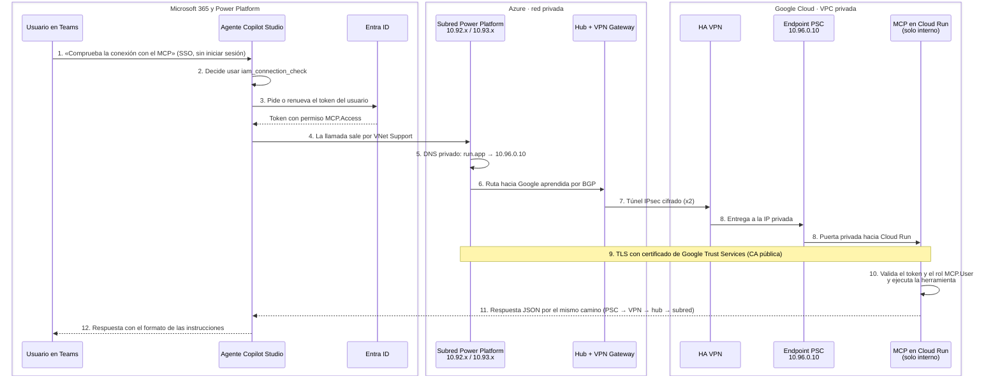
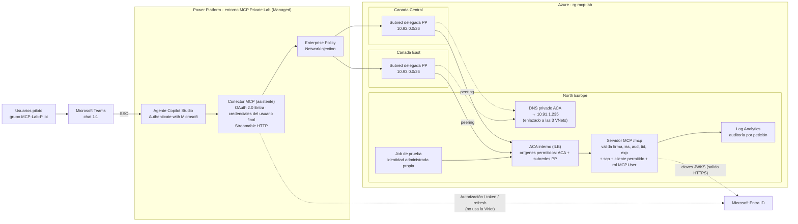
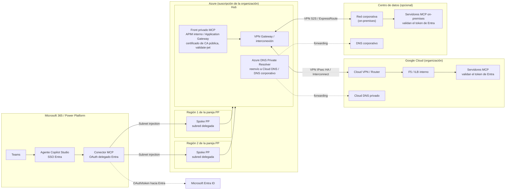
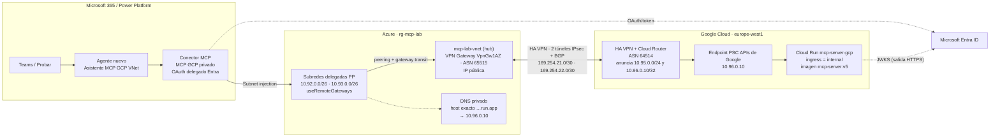
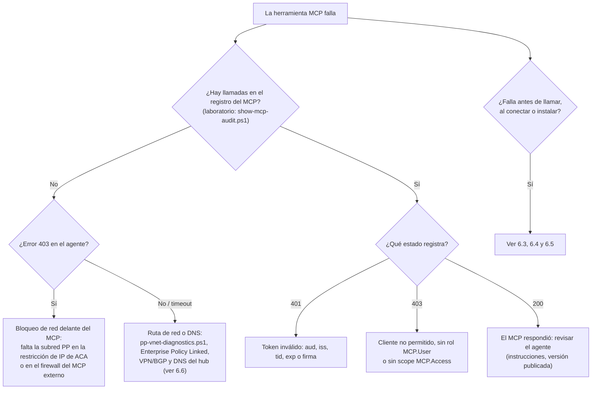

# Agentes de Copilot Studio con servidores MCP privados, OAuth delegado y Teams

Laboratorio que demuestra cómo conectar un agente de Copilot Studio publicado en Teams a un
servidor MCP **sin exposición a Internet** y **con la identidad del usuario (OAuth delegado)**,
sin usar el On-premises Data Gateway.

El servidor MCP puede estar **en cualquier red alcanzable de forma privada desde Azure**: en una
VNet de Azure, en **Google Cloud** o **on-premises**, conectado mediante VPN, ExpressRoute o
Interconnect. El laboratorio incluye un MCP de prueba en Azure Container Apps para validar el
patrón de extremo a extremo, pero ese despliegue es **opcional** (Paso 2A). Si ya existe un MCP,
se usa el Paso 2B con los datos de la [sección 3.1](#31-datos-necesarios-del-servidor-mcp).

| Documento | Contenido |
|---|---|
| Este README | Arquitectura, guía de configuración paso a paso, pruebas y troubleshooting |
| [config/lab.config.example.json](./config/lab.config.example.json) | Plantilla de configuración. Se copia como `config/lab.config.json` (ignorado por git) con los valores de tu tenant; los scripts la leen (ver [Paso 0](#paso-0-preparar-la-configuración-local)) |

> Laboratorio validado en un tenant de pruebas, con **datos sintéticos**. El entorno Power Platform
> es de tipo *Production* por decisión expresa, pero es experimental: no implica que la arquitectura
> esté certificada ni lista para producción. No se guardan secretos ni tokens en este repositorio.
>
> **Valores de ejemplo:** los identificadores del tenant de pruebas se han sustituido por marcadores
> como `<TENANT_ID>` o `<MCP_HOST>`, que coinciden con los campos de `config/lab.config.json`. Las
> evidencias exportadas (auditorías, diagnósticos) y la bitácora del montaje no se publican porque
> contienen identificadores del tenant; las tablas de resultados citan el nombre del fichero original.

---

## Cómo funciona, explicado de forma sencilla

**La idea en una frase:** Teams y Copilot Studio están en la nube de Microsoft, y el MCP está en
Google Cloud **sin acceso desde Internet**. Para hablar con él, la llamada sale de Power Platform
**por una red privada de Azure**, cruza a Google por un **túnel VPN cifrado** y llega al MCP **con la
identidad del usuario**.

A continuación, el recorrido de una pregunta en el agente **Asistente MCP GCP VNet** (opción 2C),
desde que el usuario escribe en Teams hasta que ve la respuesta.

**1. El usuario pregunta en Teams.**
Por ejemplo, Aadi escribe «Comprueba la conexión con el MCP» en el chat del agente. Teams ya sabe quién
es, así que no le pide iniciar sesión (SSO).

**2. El agente decide usar la herramienta.**
El agente de Copilot Studio lee sus instrucciones, ve que debe usar `iam_connection_check` y prepara
una llamada al servidor MCP.

**3. Obtiene un «pase» con la identidad del usuario.**
Para llamar al MCP necesita un **token de Entra ID** que diga «soy Aadi y tengo permiso `MCP.Access`».
- El usuario lo autoriza **una sola vez**, al pulsar *Conectar* la primera vez.
- Desde entonces, su conexión guarda ese pase y lo renueva sola cuando caduca.

Este paso va **directamente a Microsoft Entra ID**, no por la red privada, porque Entra es un servicio
de Microsoft.

**4. La llamada sale por la red privada de Azure.**
El entorno de Power Platform tiene **VNet Support**: la llamada no sale «a Internet», sino desde un
contenedor dentro de **nuestra subred de Azure** (10.92.x en Canada Central o 10.93.x en Canada East).

**5. El DNS privado le dice adónde ir.**
El contenedor pregunta: «¿cuál es la IP de `mcp-server-gcp-…run.app`?».
- En Internet, ese nombre apuntaría a una IP pública de Google.
- Nuestra **zona DNS privada de Azure** responde en cambio **`10.96.0.10`**, una IP privada dentro de
  Google Cloud.

**6. La red de Azure sabe cómo llegar a esa IP.**
Las subredes de Power Platform están conectadas a una VNet central (*hub*) que tiene un **VPN
Gateway**. Mediante **BGP**, el gateway y Google se han intercambiado sus rutas, así que Azure sabe que
`10.96.0.10` está «al otro lado del túnel».

**7. La llamada cruza el túnel VPN.**
Un **túnel IPsec cifrado**, en realidad dos para tener redundancia, une el VPN Gateway de Azure con el
**HA VPN** de Google Cloud. Todo el tráfico entre las dos nubes viaja por ahí.

**8. En Google Cloud, la IP privada entrega la llamada al MCP.**
`10.96.0.10` es un **endpoint Private Service Connect**: una «puerta privada» de la VPC hacia los
servicios de Google, que pasa la petición al servicio **Cloud Run** donde vive el MCP.
- Cloud Run está configurado como **solo interno**: acepta la petición porque llega desde la red
  privada (la VPN).
- Si alguien lo intentara desde Internet, recibiría un **404**.

**9. Se comprueba el certificado.**
El MCP presenta el certificado de `run.app`, emitido por **Google Trust Services**, una CA pública.
Power Platform lo acepta; con un certificado de una CA interna rechazaría la conexión
([sección 2.6](#26-certificado-tls-del-mcp-qué-es-una-ca-y-qué-exige-power-platform)).

**10. El MCP comprueba el pase del usuario.**
Antes de hacer nada, el MCP verifica el token:
- que lo ha firmado Entra ID y es de nuestro tenant;
- que está vigente y es para esta API;
- que tiene el permiso `MCP.Access`;
- que lo pidió el **conector autorizado** y no otra aplicación;
- que el usuario tiene el rol **`MCP.User`**, es decir, que pertenece al grupo piloto.

Si todo es correcto, ejecuta la herramienta y responde con un JSON: quién es el usuario (`objectId`,
modo `delegated`) y dónde se ejecuta el MCP (`runtime: gcp-cloud-run-europe-west1`). Si no, responde
con 401 o 403 y no ejecuta nada.

**11. La respuesta vuelve por el mismo camino.**
MCP → endpoint PSC → túnel VPN → hub de Azure → subred de Power Platform → agente.

**12. El agente la presenta en Teams.**
El agente aplica las instrucciones de formato (bloque JSON con Origen, Estado, Modo y Datos
sintéticos) y el usuario ve la respuesta en el chat.



**Qué lo hace privado y seguro**

| Pieza | Para qué sirve |
|---|---|
| **VNet Support de Power Platform** | La llamada sale desde **nuestra** red de Azure, sin necesitar el gateway on-premises |
| **DNS privado** | Envía el nombre del MCP a su IP **privada**, no a la pública |
| **VPN con BGP** | Une Azure y Google de forma **cifrada** y les dice cómo llegar a cada red |
| **Private Service Connect + Cloud Run interno** | El MCP **solo acepta tráfico de la red privada**; desde Internet devuelve 404 |
| **Certificado de CA pública** | Requisito de Power Platform para aceptar la conexión TLS |
| **Token de Entra validado por el MCP** | Cada llamada va **con la identidad del usuario**, y solo se atiende si está autorizado |

**En resumen:** la red decide **por dónde** viaja la llamada (siempre por caminos privados), y el token
decide **quién** puede usar la herramienta (solo los usuarios autorizados, con su propia identidad).

> **¿Y el agente de Azure (Asistente MCP Azure VNet)?** Sigue el mismo recorrido, pero más corto:
> como su MCP está en Azure Container Apps, no hay VPN ni Google Cloud. En el paso 5, el DNS privado
> devuelve la IP interna de ACA (`10.91.1.235`). En los pasos 6 a 8, la subred de Power Platform llega
> al MCP directamente por el *peering* con la VNet del MCP. El resto, incluidos el token del usuario y
> sus comprobaciones, es idéntico.
>
> **¿Y un MCP on-premises?** Igual que GCP, pero el túnel termina en el centro de datos (VPN
> site-to-site o ExpressRoute) y el DNS reenvía al DNS corporativo.

---

## Índice

0. [Cómo funciona, explicado de forma sencilla](#cómo-funciona-explicado-de-forma-sencilla)
1. [Resumen](#1-resumen)
2. [Arquitectura](#2-arquitectura)
3. [Requisitos previos](#3-requisitos-previos)
4. [Guía de configuración](#4-guía-de-configuración)
5. [Pruebas y resultados](#5-pruebas-y-resultados)
6. [Troubleshooting](#6-troubleshooting)
7. [Recomendaciones](#7-recomendaciones)
8. [Recursos del laboratorio, costes y retirada](#8-recursos-del-laboratorio-costes-y-retirada)
9. [Contenido del repositorio](#9-contenido-del-repositorio)
10. [Referencias](#10-referencias)

---

## 1. Resumen

**Problema:** en un conector personalizado de Power Platform no se conseguía combinar
autenticación OAuth y conectividad privada. Al activar el On-premises Data Gateway desaparecía la
opción OAuth.

**Solución:** sustituir el gateway por **Power Platform Virtual Network (VNet) Support**. Las llamadas
del conector al MCP salen por subredes de Azure delegadas al entorno, y desde ahí llegan al MCP por
la red privada: peering en Azure, o VPN/ExpressRoute hacia GCP u on-premises. La autenticación
OAuth se hace directamente contra Microsoft Entra ID. Las dos capacidades dejan de competir.

**Resultado del laboratorio (20/11/2026):**

| Capacidad | Estado |
|---|---|
| MCP sin entrada pública (Azure Container Apps interno) | ✅ Demostrado |
| Ruta privada Power Platform → MCP **sin gateway**, desde las dos regiones del entorno | ✅ Demostrado |
| OAuth **delegado** por usuario a través de esa ruta privada | ✅ Demostrado |
| El tráfico del conector va **realmente** por las subredes delegadas (prueba de bloqueo) | ✅ Demostrado |
| Agente publicado en **Teams**, con SSO en el chat 1:1 | ✅ Demostrado |
| Segundo usuario con **su propia identidad** | ✅ Demostrado |
| Usuario sin autorización rechazado | ⏳ Pendiente (E3) |
| Renovación y revocación de tokens | ⏳ Pendiente (E4, E5) |
| Conexión con un MCP **en Google Cloud** dentro de una VPC, sin acceso desde Internet, por VPN (opción 2C) | ✅ Demostrado: llamadas MCP delegadas desde Copilot Studio llegan al MCP de Cloud Run por la VPN |
| Conexión con un MCP **on-premises** a través del hub | 📐 Mismo patrón que GCP (hub + VPN/ExpressRoute); se valida en el entorno de la organización con los datos de la sección 3.1 |

El laboratorio prueba dos recorridos completos:

- **Azure:** Power Platform → red privada de Azure → MCP en ACA.
- **GCP:** Power Platform → red privada de Azure → VPN Gateway → HA VPN → VPC de GCP → MCP en Cloud Run.

Un MCP on-premises usa el mismo tramo de hub y VPN o ExpressRoute que GCP; no cambia nada en Power
Platform ni en Copilot Studio.

---

## 2. Arquitectura

### 2.1 Laboratorio desplegado



La región de Azure de las subredes **no se elige libremente**: la fija la ubicación del entorno
Power Platform. Este laboratorio está en Canadá (pareja Canada Central + Canada East) porque la
suscripción de pruebas no admitía West Europe (ver [6.1](#61-azure-y-despliegue)). Para un entorno en
la geografía *Europe*, la pareja es West Europe + North Europe.

### 2.2 Arquitectura de referencia (MCP en Google Cloud u on-premises)



Claves de la arquitectura de referencia:

- **Sin gateway:** la ruta privada la proporciona VNet Support.
- **Las subredes delegadas son *spokes* de un hub** que tiene la puerta de enlace VPN o ExpressRoute
  (*gateway transit*). Las rutas hacia GCP y on-premises llegan por BGP.
- **Certificado TLS de CA pública** en el punto de entrada del MCP. Es un requisito **oficial**:
  Power Platform exige un certificado con la cadena completa de una CA reconocida y no admite añadir
  CA raíz propias. Qué significa y cómo comprobarlo, en la
  [sección 2.6](#26-certificado-tls-del-mcp-qué-es-una-ca-y-qué-exige-power-platform).
- **DNS:** las subredes delegadas usan el DNS configurado en **su** VNet. El FQDN del MCP debe
  resolverse a una IP privada desde **las dos** regiones de la pareja; por ejemplo, con Private
  Resolver y reenvío a Cloud DNS o al DNS corporativo. Ese DNS **no puede cambiarse** con la
  política vinculada.
- **Identidad única Entra:** los MCP de GCP u on-premises validan el mismo contrato JWT que el MCP
  del laboratorio.
- **APIM** (recomendado si hay varios MCP): centraliza TLS público, `validate-jwt`, cuotas y logs.

### 2.3 Dónde puede estar el servidor MCP

| Ubicación del MCP | Conectividad desde las subredes de Power Platform | DNS | Paso 2 |
|---|---|---|---|
| **MCP de prueba en ACA** (laboratorio) | Peering directo con la VNet del MCP | Zona privada de ACA enlazada a las VNets de Power Platform | 2A (opcional) |
| **MCP de prueba en Cloud Run (GCP)** (laboratorio, validado) | Gateway transit por el VPN Gateway del hub + HA VPN hacia la VPC; Cloud Run interno a través de un endpoint PSC | Zona privada de Azure con el nombre exacto `…run.app` → IP del endpoint PSC | 2C (opcional) |
| **Otra VNet de Azure** (AKS, App Service con Private Endpoint, VM, APIM interno…) | Peering directo, o peering con el hub | Zona privada enlazada, o Private Resolver | 2B |
| **Google Cloud** | Peering con el hub + VPN HA o Cross-Cloud Interconnect hacia GCP (*gateway transit*) | Private Resolver con reenvío al *inbound forwarder* de Cloud DNS | 2B |
| **On-premises** | Peering con el hub + VPN site-to-site o ExpressRoute (*gateway transit*) | Private Resolver con reenvío al DNS corporativo, o DNS corporativo en la VNet | 2B |

En todos los casos se aplican los mismos requisitos al MCP: Streamable HTTP, certificado de CA pública,
reglas de firewall que admitan las subredes de Power Platform y validación del token de Entra
(ver [3.1](#31-datos-necesarios-del-servidor-mcp)).

### 2.4 Qué significa «privado» en esta solución

- El MCP **no tiene entrada pública**. En el laboratorio es un entorno de Container Apps interno
  (`ingress.external: true` significa «accesible desde la VNet», no desde Internet). En GCP u
  on-premises, es una IP privada detrás del F5 o del balanceador interno.
- **No pasan por la VNet:** el inicio de sesión y la obtención de tokens con Entra ID, ni el propio
  servicio de Teams o Copilot Studio. Son servicios SaaS de Microsoft. Lo que no se expone son
  **los servidores y sistemas de la organización**.

### 2.5 Control de acceso por capas

| Capa | Control | Dónde se configura | Verificado |
|---|---|---|---|
| Red | Solo las subredes autorizadas llegan al MCP | Laboratorio: `ipSecurityRestrictions` de ACA. MCP externo: firewall de GCP, firewall on-premises o NSG | ✅ Prueba C2 |
| Entorno Power Platform | Solo los miembros del grupo de seguridad del entorno | Grupo de seguridad del entorno | ⏳ E3 |
| Agente | Con quién se comparte el agente | Copilot Studio → Compartir | ✅ E2 |
| Conector | Quién puede leer el conector para crear su conexión | Dataverse: equipo + uso compartido del conector | ✅ E2 |
| Entra ID | Solo los usuarios con el rol `MCP.User` obtienen token | Asignación obligatoria en la aplicación API | ⏳ E3/E5 |
| Servidor MCP | Exige scope `MCP.Access`, cliente del conector permitido y rol `MCP.User` | Laboratorio: código (`src/auth.mjs`) y variables de la app. MCP externo: su validación de tokens | ✅ Pruebas locales y C1 |

Registros de aplicación de Entra que intervienen (mezclarlos es la causa más habitual de fallos):

| Aplicación | Función |
|---|---|
| **API del MCP** (`mcp-lab-api`) | Recurso protegido. Scope delegado `MCP.Access`; roles `MCP.User` (usuarios) y `MCP.Probe` (job de prueba); asignación obligatoria |
| **Cliente OAuth del conector** (`mcp-lab-connector`) | La usa el conector para pedir tokens en nombre del usuario. Redirect URI = callback del asistente MCP |
| *App SSO del agente* (solo contingencia) | Solo es necesaria si el agente usa *Authenticate manually*. No es necesaria con *Authenticate with Microsoft* |

### 2.6 Certificado TLS del MCP: qué es una CA y qué exige Power Platform

Este requisito es fácil de pasar por alto y bloquea la conexión aunque la red, el DNS y OAuth estén
bien configurados. **No impide la solución**: solo condiciona qué certificado debe presentar el MCP.

**Qué es un certificado TLS.** Cuando un cliente se conecta por HTTPS, el servidor le presenta un
certificado: un documento digital que dice «soy `mcp.ejemplo.es`». Sirve para dos cosas: que el
cliente compruebe que habla con el servidor correcto y no con un impostor, y cifrar la comunicación.

**Qué es una CA (autoridad de certificación).** Es la entidad que **emite y firma** los
certificados y garantiza que cada uno pertenece a quien dice. Una analogía: el certificado es el
«DNI» del servidor y la CA es quien lo expide. El cliente solo acepta el certificado si lo ha firmado
una CA **en la que confía**. Cada sistema operativo, navegador o servicio trae una lista de CA de
confianza preinstalada: su *almacén de confianza*.

**CA pública y CA privada (interna)**

| | CA pública | CA privada o interna |
|---|---|---|
| Quién es | Empresas reconocidas internacionalmente: DigiCert, Sectigo, GlobalSign, Let's Encrypt, Microsoft… | La propia organización, por ejemplo la CA corporativa o la de un proveedor de servicios (Active Directory Certificate Services, PKI propia…) |
| Quién confía en ella | Prácticamente todos los sistemas: navegadores, Windows, Azure, **Power Platform**. Viene preinstalada | Solo los equipos en los que la organización ha instalado su certificado raíz |
| Qué pide para emitir un certificado | Demostrar que controlas el **dominio público**, normalmente con un registro DNS | Lo que decida la organización |
| Coste | Desde gratis (Let's Encrypt) hasta cientos de euros al año | Interno |
| Uso típico | Servicios que deben ser aceptados por clientes externos | Servicios internos usados solo por equipos corporativos |

**Cadena de certificados.** El certificado del servidor suele estar firmado por una CA
**intermedia**, que a su vez está firmada por la CA **raíz**. El servidor debe enviar su certificado
**y los intermedios** (la *cadena completa*) para que el cliente pueda llegar hasta una raíz de
confianza. Ejemplo real: `learn.microsoft.com` presenta un certificado emitido por *Microsoft TLS G2
ECC CA OCSP 06* (intermedia), cuya raíz es *DigiCert Global Root G3* (pública).

**Qué exige Power Platform.** Las llamadas del conector al MCP salen de contenedores de Power Platform
cuyo almacén de confianza **solo incluye CA públicas y no se puede ampliar**. Lo indica la
documentación oficial de Microsoft, en la pregunta frecuente de VNet Support sobre certificados de CA
no reconocidas:

> 📄 **Microsoft Learn — Azure Virtual Network support for Power Platform, FAQ:**
> [*My on-premises endpoint TLS certificates aren't signed by well-known root certification
> authorities (CA). Do you support unknown certificates?*](https://learn.microsoft.com/en-us/power-platform/admin/vnet-support-overview#my-on-premises-endpoint-tls-certificates-arent-signed-by-well-known-root-certification-authorities-ca-do-you-support-unknown-certificates)
>
> *«No. Power Platform requires the endpoint to present a TLS certificate with the complete chain.
> You can't add your custom root CA to the list of well-known CAs.»*
>
> Traducción: «No. Power Platform exige que el endpoint presente un certificado TLS con la cadena
> completa. No se puede añadir una CA raíz propia a la lista de CA reconocidas.»

Por tanto:

| Si el MCP presenta… | Resultado |
|---|---|
| Certificado de CA pública, cadena completa, nombre (SAN) = FQDN del MCP, vigente | ✅ Funciona |
| Certificado de una CA interna (corporativa o del proveedor) | ❌ Falla la conexión TLS, aunque todo lo demás esté bien |
| Certificado autofirmado, caducado, sin intermedios o con otro nombre | ❌ Falla la conexión TLS |

**Certificado público no significa servidor expuesto.** Un certificado de CA pública solo exige que el
nombre del MCP pertenezca a un **dominio público registrado** de la organización (por ejemplo
`mcp.<dominio>.es`; no sirven nombres como `.local` o `.corp`). Ese nombre puede resolverse
**solo dentro de la red privada** (DNS dividido o *split-horizon*): la CA valida la propiedad del
dominio con un registro en el DNS público, sin conectarse al servidor. El MCP sigue sin entrada pública.

**Cómo saber qué certificado presenta el MCP**

1. **Comprobación definitiva, desde Power Platform** (Paso 4.5): `pp-vnet-diagnostics.ps1` devuelve,
   en `tls`, el emisor (`certificate.issuer`), si es autofirmado (`isSelfSigned`), si ha caducado
   (`isExpired`) y los errores de validación (`sslErrors`). `sslErrors: None` significa que Power
   Platform acepta el certificado.
2. **Comprobación previa, desde un equipo de la red interna** que llegue al MCP:

   ```powershell
   $fqdn = 'mcp.ejemplo.es'          # nombre del certificado (dato 1 de la sección 3.1)
   $target = '10.20.30.40'                # IP privada del MCP o del F5 (dato 3); o el propio FQDN
   $tcp = [Net.Sockets.TcpClient]::new($target, 443)
   $ssl = [Net.Security.SslStream]::new($tcp.GetStream(), $false, { $true })
   $ssl.AuthenticateAsClient($fqdn)
   $cert = [Security.Cryptography.X509Certificates.X509Certificate2]$ssl.RemoteCertificate
   $chain = [Security.Cryptography.X509Certificates.X509Chain]::new(); [void]$chain.Build($cert)
   [pscustomobject]@{
     Nombre = ($cert.DnsNameList.Unicode | Select-Object -First 3) -join ', '
     Emisor = $cert.Issuer
     Raiz   = $chain.ChainElements[-1].Certificate.Subject
     Caduca = $cert.NotAfter
     TLS    = $ssl.SslProtocol
   } | Format-List
   $ssl.Dispose(); $tcp.Dispose()
   ```

   Si **Raíz** es una CA pública conocida (DigiCert, Sectigo, GlobalSign, ISRG/Let's Encrypt,
   Microsoft…), es válido. Si contiene el nombre de la organización (por ejemplo *Contoso Root CA*), es
   una **CA interna**. No basta con que el equipo diga que la cadena es válida: los equipos
   corporativos suelen confiar también en la CA interna, y Power Platform no.

**Qué hacer si el MCP usa una CA interna**

| Opción | Qué implica |
|---|---|
| **1. Certificado de CA pública en el F5 o en el MCP** (la más sencilla) | Usar un nombre de un dominio público de la organización con DNS dividido, y emitir el certificado con una CA pública. Si los MCP ya se publicaban en Internet a través del F5, **probablemente ya exista** un certificado público reutilizable con el mismo nombre |
| **2. Front privado en Azure** (APIM interno o Application Gateway) | El front presenta un certificado público a Power Platform y reenvía al MCP aceptando la CA interna. Encaja si además se quieren centralizar varios MCP (sección 2.2) |

En el laboratorio, el MCP de ACA presenta un certificado de una CA pública de Microsoft
(*Microsoft TLS G2 RSA CA OCSP 02*), y los diagnósticos desde Power Platform lo validaron en las dos
regiones (`sslErrors: None`).

---

## 3. Requisitos previos

| Requisito | Detalle |
|---|---|
| Roles y permisos | Ver [3.0.2](#302-permisos-por-área) |
| Herramientas | Ver [3.0.1](#301-herramientas-y-versiones-mínimas) |
| Licencias | Capacidad de Dataverse para un entorno; Managed Environments; Copilot Studio; usuarios con Teams; Entra ID P1 para asignar roles de aplicación a grupos |
| Regiones | Poder crear VNets en **las dos** regiones Azure que corresponden a la ubicación del entorno Power Platform ([tabla oficial](https://learn.microsoft.com/en-us/power-platform/admin/vnet-support-overview#supported-regions)) |
| Conectividad (MCP externo) | Hub de Azure con VPN Gateway o ExpressRoute hacia GCP u on-premises, y rangos IP **sin solapamiento** entre Azure, GCP y on-premises (ver [3.0.3](#303-plan-de-direcciones-ip)) |
| Políticas del tenant | Que Microsoft 365 y Teams permitan instalar agentes creados por la organización |

### 3.0.1 Herramientas y versiones mínimas

Cada herramienta configura una parte de la solución. Con una versión demasiado antigua, un comando
puede no existir o devolver campos con otro nombre, y parecería que la configuración está mal cuando
el problema es la herramienta.

| Herramienta | Qué configura | Versión mínima | Por qué | Probado con |
|---|---|---|---|---|
| PowerShell | Ejecuta los scripts de `tools/` e `infra/gcp/` | **7.0** | `infra/gcp/setup-gcp-network.ps1` genera la clave IPsec con `RandomNumberGenerator.Fill`, que no existe en Windows PowerShell 5.1 | 7.6.10 |
| Azure CLI | Entra ID, redes, VPN Gateway, DNS privado y Enterprise Policy | **2.37.0** | Primera versión en la que `az ad …` usa Microsoft Graph ([documentación](https://learn.microsoft.com/en-us/cli/azure/microsoft-graph-migration)). Antes, los campos cambian (`objectId` en lugar de `id`) | 2.93.0 |
| Bicep | Plantillas de `infra/` | La que instala Azure CLI (`az bicep install`) | — | Incluida en Azure CLI |
| Google Cloud CLI | Red de GCP y Cloud Run (opción 2C) | Sin mínimo publicado: comprobar las opciones (abajo) | — | 575.0.0 |
| Power Platform CLI (`pac`) | Entorno y Managed Environment | Sin mínimo publicado: comprobar las opciones (abajo) | — | 2.15.1 |
| Node.js | Solo para las pruebas locales del MCP de laboratorio (`npm test`) | 22 | `package.json` (`engines`) | 22 |

Ver las versiones. No uses `az version --query '"azure-cli"'`: PowerShell quita las comillas
internas y el comando falla.

```powershell
$PSVersionTable.PSVersion
(az version -o json | ConvertFrom-Json).'azure-cli'
gcloud version | Select-Object -First 1
pac help | Select-Object -First 2
```

Comprobar que existen las opciones que usa la guía. Es el criterio fiable cuando no hay una versión
mínima publicada. Tarda de 2 a 4 minutos y debe devolver **OK** en todas las líneas; si alguna dice
**FALTA**, actualiza esa herramienta (`az upgrade`, `gcloud components update`, `pac install latest`):

```powershell
function Test-Opcion([string] $Comando, [string] $Opcion) {
    $ayuda = (Invoke-Expression "$Comando --help 2>&1") | Out-String
    '{0,-42} {1,-26} {2}' -f $Comando, $Opcion, $(if ($ayuda -match [regex]::Escape($Opcion)) { 'OK' } else { 'FALTA' })
}
Test-Opcion 'az ad app credential reset'              'display-name'
Test-Opcion 'az network vnet subnet update'           'delegations'
Test-Opcion 'az network vnet peering create'          'use-remote-gateways'
Test-Opcion 'az network private-dns link vnet create' 'registration-enabled'
Test-Opcion 'gcloud run deploy'                       'no-invoker-iam-check'
Test-Opcion 'gcloud compute vpn-gateways create'      'stack-type'
Test-Opcion 'gcloud compute forwarding-rules create'  'target-google-apis-bundle'
Test-Opcion 'pac admin create'                        'macro-region'
Test-Opcion 'pac admin set-governance-config'         'protection-level'
Test-Opcion 'pac environment-management'              'get-supported-locations'
```

### 3.0.2 Permisos por área

En la organización, cada parte suele corresponder a un equipo distinto. Conviene pedir los permisos
antes de empezar.

| Dónde | Permiso | Para qué |
|---|---|---|
| Entra ID | Application Administrator o Cloud Application Administrator | Registrar las aplicaciones de la API y del cliente, y conceder el consentimiento de administrador |
| Entra ID | Groups Administrator, o ser propietario del grupo | Crear el grupo del piloto y gestionar sus miembros |
| Azure | Network Contributor (o Contributor) en la suscripción | VNets, peering, VPN Gateway, DNS privado y Enterprise Policy |
| Azure | Proveedores `Microsoft.Network` y `Microsoft.PowerPlatform` registrados | Sin `Microsoft.PowerPlatform`, la suscripción no admite el recurso de Enterprise Policy |
| Power Platform | Power Platform Administrator | Crear el entorno, activar Managed Environment y vincular la política |
| Google Cloud (2C) | `compute.networkAdmin`, `run.admin`, `dns.admin` y `servicedirectory.editor` | VPC, VPN, Cloud Router, endpoint PSC y Cloud Run |

```powershell
az provider show -n Microsoft.PowerPlatform --query registrationState -o tsv   # Registered
az provider show -n Microsoft.Network --query registrationState -o tsv         # Registered
# Si no: az provider register -n Microsoft.PowerPlatform
```

### 3.0.3 Plan de direcciones IP

Azure, GCP y on-premises se intercambian rutas por BGP. **Si dos redes comparten rango, el tráfico no
sabe adónde ir.** Además, una subred delegada a Power Platform no se puede redimensionar sin abrir un
caso a Microsoft. Por eso, antes de crear nada:

- pide al equipo de red los rangos que ya se usan en Azure, GCP y on-premises;
- reserva **dos rangos libres** para las VNets de Power Platform, uno por región, con subredes
  delegadas **del mismo tamaño**. Un entorno que no es de producción usa entre 6 y 10 IP y uno de
  producción entre 25 y 30. El laboratorio usa `/26` (64 direcciones, 5 reservadas por Azure).

| Red del laboratorio | Rango |
|---|---|
| Hub y MCP de ACA (`GatewaySubnet` `10.91.255.0/27`) | `10.91.0.0/16` |
| Power Platform (Canada Central / Canada East) | `10.92.0.0/24` / `10.93.0.0/24` (subredes `/26`) |
| VPC de GCP / endpoint PSC | `10.95.0.0/24` / `10.96.0.10/32` |
| BGP de los túneles (APIPA) | `169.254.21.0/30` y `169.254.22.0/30` |

### 3.1 Datos necesarios del servidor MCP

Si el MCP ya existe (GCP, on-premises u otra red), hay que pedir estos datos al equipo propietario
**antes de empezar**. La tercera columna muestra el valor del laboratorio como
ejemplo.

| # | Dato | Ejemplo (laboratorio) | Para qué se usa |
|---|---|---|---|
| **Endpoint** ||||
| 1 | URL completa del MCP (HTTPS, FQDN y ruta) | `https://<MCP_HOST>/mcp` | *Server URL* del asistente MCP (Paso 6) |
| 2 | Transporte MCP | Streamable HTTP | Copilot Studio **solo** admite Streamable HTTP; SSE ya no está soportado |
| 3 | IP privada (VIP) del punto de entrada y puerto | `10.91.1.235:443` | Diagnóstico TCP y reglas de firewall |
| **TLS** ||||
| 4 | Certificado: emisor, CA raíz, SAN y cadena completa | Emisor *Microsoft TLS G2 RSA CA OCSP 02* (CA pública) | **Requisito:** CA pública, SAN = FQDN del punto 1, cadena completa, TLS 1.2 o superior. Ver [2.6](#26-certificado-tls-del-mcp-qué-es-una-ca-y-qué-exige-power-platform) |
| **DNS** ||||
| 5 | Zona DNS del FQDN y servidores que la resuelven | Zona privada de ACA (Azure DNS) | Reglas de reenvío del Private Resolver o DNS de las VNets de Power Platform |
| 6 | IP del *inbound forwarder* de Cloud DNS o del DNS corporativo | — | Destino del reenvío condicional |
| **Red** ||||
| 7 | Rangos IP de la red del MCP (GCP, on-premises) | `10.91.0.0/16` | Comprobar que no se solapan; rutas BGP |
| 8 | Tipo de interconexión con Azure y quién la gestiona | Peering de VNet | VPN HA, Interconnect, VPN S2S o ExpressRoute; hub existente o nuevo |
| 9 | Datos de la VPN: IP pública del extremo, ASN BGP, parámetros IKE/IPsec | — | Local Network Gateway y conexión. **La clave compartida se intercambia por un canal seguro, nunca en documentos** |
| 10 | Firewall delante del MCP | Restricción de IP de ACA | Abrir TCP 443 **desde las dos subredes delegadas** de Power Platform (Paso 4) |
| 11 | SNAT o NAT intermedios | Ninguno | Si hay NAT, la lista de IP de origen permitidas cambia |
| **Autenticación** ||||
| 12 | ¿El MCP puede validar tokens de Entra ID? | Sí (`src/auth.mjs`) | Contrato de la tabla siguiente |
| 13 | Si usa otro proveedor OAuth: URL de autorización, de token y de refresh | — | Asistente MCP. Esas URL deben ser **públicamente accesibles**, porque OAuth no pasa por la VNet |
| 14 | Salida del MCP hacia `login.microsoftonline.com` (claves JWKS) | Sí | Sin ella, el MCP no puede validar firmas |
| **Operación** ||||
| 15 | Endpoint de salud y respuesta sin token | `/healthz`; `POST /mcp` sin token → 401 | Diagnóstico |
| 16 | Dónde se registran las llamadas y si incluyen un identificador de petición | Log Analytics con `requestId` | Correlación de pruebas y troubleshooting |
| 17 | Contacto técnico y ventana de cambios | — | Coordinación de las pruebas de bloqueo |

**Contrato de validación del token** que debe implementar el MCP (el del laboratorio está en
[src/auth.mjs](./src/auth.mjs)):

| Claim | Valor esperado | Si no coincide |
|---|---|---|
| Firma | RS256 con las claves JWKS de `https://login.microsoftonline.com/<tenant>/discovery/v2.0/keys` | 401 |
| `iss` | `https://login.microsoftonline.com/<tenant>/v2.0` | 401 |
| `aud` | appId de la API del MCP (Paso 1) | 401 |
| `tid` | ID del tenant | 401 |
| `exp`, `iat` | Token vigente | 401 |
| `scp` | Contiene `MCP.Access` | 403 |
| `azp` | Client ID del cliente OAuth del conector (Paso 5) | 403 |
| `roles` | Contiene `MCP.User` | 403 |
| Identidad del usuario | `oid` (y `upn`, si se necesita) para aplicar los permisos sobre los sistemas de la organización | — |

> **Consejo para Windows:** en `az rest`, pasa siempre el cuerpo JSON en un fichero (`--body "@fichero.json"`)
> y añade `--headers Content-Type=application/json`. El JSON escrito directamente en la línea de
> comandos falla por el entrecomillado (ver [6.1](#61-azure-y-despliegue)).

---

## 4. Guía de configuración

| Paso | Qué se configura | Dónde | Tiempo aprox. |
|---|---|---|---|
| 0 | Repositorio y configuración local (`config/lab.config.json`) | PowerShell | 5 min |
| 1 | Identidades en Entra ID | CLI | 10 min |
| 2 | Servidor MCP: **2A** MCP de prueba en ACA (opcional, laboratorio), **2B** preparar un MCP existente (GCP, on-premises u otra red) **o 2C** MCP de prueba en GCP por VPN (opcional, laboratorio) | CLI / equipo propietario del MCP | 20 min / variable / 1,5 h |
| 3 | Entorno Power Platform y Managed Environment | CLI | 15 min |
| 4 | VNet Support y conectividad con el MCP | CLI (+ equipo de red si el MCP es externo) | 15 min + hasta 30 min de propagación |
| 5 | Aplicación cliente OAuth del conector | CLI | 5 min |
| 6 | Agente y herramienta MCP en Copilot Studio | Portal + CLI | 15 min |
| 7 | Publicación en Teams | Portal | 10 min |
| 8 | Acceso de otros usuarios | CLI + Portal | 10 min |

> Los pasos marcados **[Laboratorio]** solo se aplican al MCP de prueba en ACA. Los marcados
> **[MCP externo]** solo se aplican cuando el MCP está en GCP, on-premises u otra red. El resto es común.

### Paso 0. Preparar la configuración local

Todos los comandos se ejecutan desde la carpeta del repositorio, con **PowerShell 7** y con cada
herramienta apuntando al tenant, la suscripción y el proyecto correctos. Las sesiones de `az`, `gcloud`
y `pac` son independientes, y cualquiera puede seguir apuntando a un trabajo anterior:

```powershell
az account show --query "{tenant:tenantId, suscripcion:name, usuario:user.name}" -o table
# Si no es el tenant o la suscripción correctos: az login --tenant <TENANT_ID>; az account set --subscription <SUBSCRIPTION_ID>
pac auth list                        # el perfil activo (*) debe ser de un administrador de Power Platform del tenant
# Si no: pac auth select --index <n>, o pac auth create --name <nombre> (inicio de sesión interactivo; --tenant es solo para aplicaciones)
gcloud config get-value project      # solo opción 2C
```

```powershell
git clone https://github.com/asevillano/mcp-private-lab.git
Set-Location mcp-private-lab
Copy-Item config\lab.config.example.json config\lab.config.json
```

[config/lab.config.json](./config/lab.config.example.json) guarda los valores de **tu** tenant y está
en `.gitignore`, así que nunca se sube al repositorio. Los scripts de `tools/` e `infra/gcp/` leen de
él cualquier parámetro que no se les pase (cada parámetro se puede seguir pasando a mano). Si
falta un valor, o sigue con su marcador `<...>`, el script se detiene e indica qué campo completar.
Para usar otro fichero, define `$env:MCP_LAB_CONFIG` con su ruta.

Los campos se rellenan a medida que avanza la guía:

| Campos de `config/lab.config.json` | Cuándo se completan |
|---|---|
| `tenantId`, `subscriptionId` | Ahora (`az account show --query "{tenantId:tenantId, subscriptionId:id}"`) |
| `azure.resourceGroup`, `azure.location`, `azure.namePrefix`, `azure.foundationDeployment` | Ahora: nombres que quieras usar (se pueden dejar los de ejemplo) |
| `entra.apiClientId`, `entra.apiObjectId`, `entra.apiServicePrincipalId` | Paso 1.1 |
| `entra.pilotGroupObjectId`, `entra.pilotGroupName` | Paso 1.3 |
| `azure.acrName`, `azure.logAnalyticsWorkspaceId`, `azure.probeClientId`, `mcp.host` | Paso 2A.2 (salidas del despliegue) |
| `powerPlatform.environmentId`, `powerPlatform.orgUrl` | Paso 3 |
| `powerPlatform.regions`, `powerPlatform.delegatedSubnetCidrs` | Paso 4 (pareja de regiones del entorno y subredes delegadas) |
| `entra.connectorClientId` | Paso 5 |
| `powerPlatform.connectorDisplayName` | Paso 6 (nombre del conector que crea el asistente MCP) |
| `gcp.*` | Paso 2C (solo si se monta el MCP de prueba en GCP) |

Carga en la sesión las variables que usan los comandos de la guía. **Vuelve a ejecutarlo cada vez
que completes campos nuevos:**

```powershell
$cfg      = Get-Content config\lab.config.json -Raw | ConvertFrom-Json
$TENANT   = $cfg.tenantId
$RG       = $cfg.azure.resourceGroup
$GROUP    = $cfg.entra.pilotGroupObjectId
$API_APP  = $cfg.entra.apiClientId
$API_OBJ  = $cfg.entra.apiObjectId
$API_SP   = $cfg.entra.apiServicePrincipalId
$ENV_ID   = $cfg.powerPlatform.environmentId
$MCP_HOST = $cfg.mcp.host
```

> Las plantillas del repositorio ([infra/api-registration.json](./infra/api-registration.json),
> [infra/connector-client-registration.json](./infra/connector-client-registration.json),
> [infra/probe-role-assignment.json](./infra/probe-role-assignment.json) y
> [connector/mcp-openapi.yaml](./connector/mcp-openapi.yaml)) contienen marcadores `<...>`. Los
> comandos de la guía generan una copia rellenada en `%TEMP%`, de modo que los ficheros del
> repositorio no cambian ni acaban con datos del tenant.

### Paso 1. Identidades en Entra ID

**1.1 Aplicación de la API del MCP**

```powershell
az ad app create --display-name 'mcp-lab-api' --sign-in-audience AzureADMyOrg
```

Anota `appId` e `id`, y el `id` del service principal que crea el segundo comando; guárdalos en
`entra.apiClientId`, `entra.apiObjectId` y `entra.apiServicePrincipalId` y recarga las variables
(Paso 0). [infra/api-registration.json](./infra/api-registration.json) define:

- el scope delegado `MCP.Access`;
- los roles `MCP.User`, para usuarios, y `MCP.Probe`, para el job de prueba;
- tokens v2;
- `identifierUris` = `api://<API_APP_ID>`, que el comando rellena con tu `appId`.

```powershell
az ad sp create --id $API_APP --query id -o tsv          # guárdalo en entra.apiServicePrincipalId y recarga antes de 1.2
(Get-Content infra\api-registration.json -Raw).Replace('<API_APP_ID>', $API_APP) |
  Set-Content "$env:TEMP\api-registration.json" -Encoding utf8
az rest --method PATCH --headers Content-Type=application/json `
  --url "https://graph.microsoft.com/v1.0/applications/$API_OBJ" --body "@$env:TEMP\api-registration.json"
```

**1.2 Exigir asignación**, para que Entra solo emita tokens a quien tenga un rol:

```powershell
'{"appRoleAssignmentRequired": true}' | Set-Content "$env:TEMP\sp.json" -Encoding ascii
az rest --method PATCH --headers Content-Type=application/json `
  --url "https://graph.microsoft.com/v1.0/servicePrincipals/$API_SP" --body "@$env:TEMP\sp.json"
```

**1.3 Grupo piloto y rol `MCP.User`**

El grupo es la **única lista de quién puede usar la solución**. Se usa en tres sitios, así que para
dar o quitar acceso basta con añadir o quitar al usuario del grupo:

| Dónde se usa | Paso | Qué controla |
|---|---|---|
| Asignación del rol `MCP.User` en la API del MCP | 1.3 | A quién emite Entra el token para el MCP (con *asignación requerida*, a nadie más) |
| Grupo de seguridad del entorno de Power Platform | 3.2 | Quién puede entrar en el entorno |
| Equipo de Dataverse con lectura del conector | 8 | Quién puede crear su propia conexión al conector |

- Los usuarios deben ser **miembros directos**: la asignación de roles de aplicación de Entra no
  tiene en cuenta los grupos anidados.
- `--mail-nickname` es obligatorio en el comando aunque el grupo de seguridad no tenga correo.
- Asignar el rol a un grupo requiere **Entra ID P1**.

```powershell
az ad group create --display-name 'MCP-Lab-Pilot' --mail-nickname 'mcp-lab-pilot' --query id -o tsv
# guarda el id en entra.pilotGroupObjectId (y el nombre en entra.pilotGroupName) y recarga las variables
az ad group member add --group $GROUP --member-id <objectId-del-usuario>
# objectId de un usuario: az ad user show --id <upn> --query "{upn:userPrincipalName, objectId:id}" -o table
# (en salida de tabla, az oculta las columnas llamadas "id": usa otro alias, como objectId)

@{ principalId = $GROUP; resourceId = $API_SP; appRoleId = '8d0f6a2e-5b8c-4f43-9e1a-2c7b6d4e9a31' } |
  ConvertTo-Json | Set-Content "$env:TEMP\role.json" -Encoding ascii
az rest --method POST --headers Content-Type=application/json `
  --url "https://graph.microsoft.com/v1.0/servicePrincipals/$API_SP/appRoleAssignedTo" --body "@$env:TEMP\role.json"
```

> El grupo del laboratorio es de seguridad y **sin correo**. Funciona en Entra, Power Platform y
> Dataverse, pero el nuevo diálogo *Compartir* de Copilot Studio no lo encontró, así que el agente se
> compartió usuario a usuario (ver [6.5](#65-acceso-de-otros-usuarios)).

### Paso 2. Servidor MCP

Elige **una** de las opciones. 2A y 2C pueden convivir en el mismo laboratorio, como ocurre en este: un
agente usa el MCP de ACA y otro, el de GCP.

#### 2A. [Laboratorio] MCP de prueba en Azure Container Apps (opcional)

Sirve para validar el patrón completo sin depender de los sistemas de la organización. Si vas a conectar un MCP
existente, salta a [2B](#2b-mcp-externo-preparar-un-mcp-existente-gcp-on-premises-u-otra-red).

El servidor ([src/](./src/)) usa el SDK oficial de MCP con transporte Streamable HTTP sin estado y
una sola herramienta sintética, `iam_connection_check`. Rechaza cualquier petición sin un token de
Entra válido y registra cada llamada **sin incluir tokens**. Su validación de tokens es la
implementación de referencia del contrato de la [sección 3.1](#31-datos-necesarios-del-servidor-mcp).

**2A.1 Pruebas locales**

```powershell
npm install --ignore-scripts
npm test          # 18/18 pruebas: firma, iss, aud, tid, exp, scope, cliente, rol y protocolo MCP
```

**2A.2 Infraestructura base** ([infra/main.bicep](./infra/main.bicep)): VNet, entorno ACA **interno**,
zona DNS privada, ACR sin usuario administrador, dos identidades administradas (runtime y prueba) y
Log Analytics.

```powershell
az group create --name $RG --location westeurope --tags purpose=MCP-OAuth-private-PoC data=synthetic-only
az deployment group create -g $RG -n $cfg.azure.foundationDeployment --template-file infra\main.bicep `
  --parameters location=$($cfg.azure.location) namePrefix=$($cfg.azure.namePrefix) registryNamePrefix=$($cfg.azure.registryNamePrefix) `
  tenantId=$TENANT `
  apiClientId=$API_APP imageName=$($cfg.mcp.imageName) imageTag=$($cfg.mcp.imageTag) `
  --query "properties.outputs.{acrName:registryName.value, logAnalyticsWorkspaceId:logAnalyticsCustomerId.value, probeClientId:probeClientId.value, probePrincipalId:probePrincipalId.value, acaDomain:environmentDomain.value}"
```

Guarda las salidas en `azure.acrName`, `azure.logAnalyticsWorkspaceId` y `azure.probeClientId`, y
pon `mcp.host` = `<mcp.appName>.<acaDomain>` (por ejemplo, `mcp-server.<ACA_DEFAULT_DOMAIN>`). Recarga
las variables.

**2A.3 Imagen del contenedor**, construida en ACR (no requiere Docker local):

```powershell
az acr build --registry $cfg.azure.acrName --image "$($cfg.mcp.imageName):$($cfg.mcp.imageTag)" --file Dockerfile . --no-logs
```

**2A.4 Rol `MCP.Probe` para la identidad de prueba**, con la salida `probePrincipalId` del paso 2A.2:

```powershell
$PROBE_PRINCIPAL = '<probePrincipalId>'
(Get-Content infra\probe-role-assignment.json -Raw).Replace('<PROBE_PRINCIPAL_ID>', $PROBE_PRINCIPAL).
  Replace('<API_SERVICE_PRINCIPAL_ID>', $API_SP) | Set-Content "$env:TEMP\probe-role.json" -Encoding utf8
az rest --method POST --headers Content-Type=application/json `
  --url "https://graph.microsoft.com/v1.0/servicePrincipals/$PROBE_PRINCIPAL/appRoleAssignments" `
  --body "@$env:TEMP\probe-role.json"
```

**2A.5 Aplicación y job de prueba.** [tools/deploy-mcp-app.ps1](./tools/deploy-mcp-app.ps1) toma las
salidas de la infraestructura base y despliega [infra/app.bicep](./infra/app.bicep). Por ahora, solo
se permite como origen la subred de ACA y no hay clientes delegados:

```powershell
.\tools\deploy-mcp-app.ps1 -AllowedSourceCidrs '10.91.0.0/23' -AllowedClientIds @()
```

**2A.6 Verificación** desde la red privada, con un token real de Entra (modo de aplicación):

```powershell
az containerapp job start -n mcp-server-probe -g $RG
az containerapp job execution list -n mcp-server-probe -g $RG -o table   # Status: Succeeded
```

El job comprueba que el DNS resuelve a una IP privada, que las peticiones sin token reciben 401 y
que `initialize`, `tools/list` y `tools/call` funcionan.

#### 2B. [MCP externo] Preparar un MCP existente (GCP, on-premises u otra red)

Con los datos de la [sección 3.1](#31-datos-necesarios-del-servidor-mcp), el equipo propietario del
MCP debe dejar preparado lo siguiente:

| # | Acción en el lado del MCP | Cómo verificarlo |
|---|---|---|
| 1 | Exponer el MCP en **Streamable HTTP** (`POST` en la ruta MCP) | Una petición `POST` sin token devuelve **401**, no 404 ni 405 |
| 2 | Presentar un **certificado de CA pública** con la cadena completa y el FQDN en el SAN ([2.6](#26-certificado-tls-del-mcp-qué-es-una-ca-y-qué-exige-power-platform)) | Comando de PowerShell de la sección 2.6 desde la red interna: la raíz debe ser una CA pública |
| 3 | Publicar el FQDN en el **DNS privado** (Cloud DNS o corporativo), resolviendo a la IP privada | `nslookup <fqdn> <dns>` desde la red interna |
| 4 | Implementar el **contrato de validación del token** de Entra (tabla de la sección 3.1), con el appId de la API (Paso 1) y el cliente del conector (Paso 5) | Un token de otra aplicación o sin el rol `MCP.User` recibe 403 |
| 5 | Permitir la **salida HTTPS** del MCP hacia `login.microsoftonline.com` para descargar las claves JWKS | Validación de un token real (Paso 6.5) |
| 6 | Preparar la regla de firewall que **admitirá TCP 443 desde las dos subredes delegadas** de Power Platform (sus rangos se definen en el Paso 4) | Diagnóstico del Paso 4.5 |
| 7 | Registrar cada llamada con un identificador de petición y la identidad (`oid`), **sin tokens** | Correlación en las pruebas (sección 5) |

> Si el MCP no puede validar tokens de Entra, valora un **front APIM interno** en Azure que haga
> `validate-jwt` y reenvíe al MCP (ver [2.2](#22-arquitectura-de-referencia-mcp-en-google-cloud-u-on-premises)).
> Con otro proveedor OAuth, sus URL de autorización y token deben ser accesibles públicamente.

#### 2C. [Laboratorio GCP] MCP en Google Cloud dentro de una VPC, a través de VPN (validado)

Reproduce de extremo a extremo el escenario de referencia: el MCP está **en Google Cloud**, sin acceso
desde Internet, y Power Platform llega a él por las subredes delegadas, el VPN Gateway de Azure y un
túnel IPsec hasta la VPC de GCP. Se usa **la misma imagen** que en 2A, y se prueba con un **agente
nuevo** de Copilot Studio, sin tocar el existente.

**Por qué Cloud Run con acceso interno y Private Service Connect**

- Cloud Run con `ingress=internal` **rechaza las peticiones de Internet** (responde 404) y acepta las
  que llegan **desde redes conectadas por Cloud VPN**, que Google considera internas
  ([documentación](https://cloud.google.com/run/docs/securing/ingress)).
- Desde la red privada se llega a la URL `*.run.app` a través de un **endpoint Private Service
  Connect (PSC) para APIs de Google**: una IP privada de la VPC que se anuncia a Azure por BGP. En
  Azure, el nombre del servicio se resuelve a esa IP con una zona DNS privada
  ([patrón documentado](https://cloud.google.com/run/docs/securing/private-networking)).
- La URL `*.run.app` presenta un certificado de **Google Trust Services**, una CA pública: cumple el
  requisito de la [sección 2.6](#26-certificado-tls-del-mcp-qué-es-una-ca-y-qué-exige-power-platform)
  **sin necesitar un dominio propio**.



**Valores del laboratorio**

| Elemento | Valor |
|---|---|
| Proyecto GCP | `<GCP_PROJECT_ID>` (número `<GCP_PROJECT_NUMBER>`), región `europe-west1` |
| VPC / subred | `mcp-lab-vpc` / `mcp-lab-subnet` `10.95.0.0/24` (Private Google Access) |
| Endpoint PSC | `mcplabpsc`, IP `10.96.0.10`, paquete `all-apis` |
| HA VPN / Cloud Router | `mcp-lab-havpn` (`<GCP_HAVPN_IP_0>`, `<GCP_HAVPN_IP_1>`) / `mcp-lab-router`, ASN `64514` |
| Túneles y BGP | `mcp-lab-tunnel0`: GCP `169.254.21.2` ↔ Azure `169.254.21.1` · `mcp-lab-tunnel1`: GCP `169.254.22.2` ↔ Azure `169.254.22.1` |
| VPN Gateway de Azure | `mcp-lab-vpngw` (VpnGw1AZ, activo-pasivo), IP `<AZURE_VPNGW_IP>`, ASN `65515`, en `GatewaySubnet` `10.91.255.0/27` |
| MCP en Cloud Run | `mcp-server-gcp`, URL `https://<CLOUD_RUN_HOST>/mcp`, imagen `europe-west1-docker.pkg.dev/<GCP_PROJECT_ID>/mcp-lab/mcp-server:v5` |
| Variables del MCP | `TENANT_ID`, `API_CLIENT_ID`, `ALLOWED_CLIENT_IDS=<CONNECTOR_APP_ID>`, `PROBE_CLIENT_ID=<PROBE_CLIENT_ID>`, `RESOURCE_URL`, `MCP_RUNTIME=gcp-cloud-run-europe-west1` |

**2C.1 Acceso y permisos en GCP**

```powershell
gcloud auth login <tu-cuenta-gcp>          # interactivo
gcloud config set project $cfg.gcp.projectId
```

La cuenta necesita, además de Cloud Run y Artifact Registry, `roles/compute.networkAdmin`,
`roles/servicedirectory.editor` y `roles/dns.admin`; los dos últimos los usa el endpoint PSC. En el
laboratorio se asignaron así, con autorización del responsable:

```powershell
foreach ($r in 'roles/compute.networkAdmin','roles/servicedirectory.editor','roles/dns.admin') {
  gcloud projects add-iam-policy-binding $cfg.gcp.projectId --member='user:<tu-cuenta-gcp>' --role=$r --condition=None
}
gcloud services enable servicedirectory.googleapis.com dns.googleapis.com --project $cfg.gcp.projectId
```

**2C.2 VPN Gateway de Azure (lanzarlo primero: tarda entre 30 y 45 min).** Se añade la
`GatewaySubnet` con un comando puntual, porque redesplegar `main.bicep` en un laboratorio existente
reescribiría la VNet (ver [6.7](#67-mcp-en-gcp-a-través-de-vpn-laboratorio)):

```powershell
$P = $cfg.azure.namePrefix; $G = $cfg.gcp.prefix
az network vnet subnet create -g $RG --vnet-name "$P-vnet" -n GatewaySubnet --address-prefixes 10.91.255.0/27
az deployment group create -g $RG -n vpn-gateway --template-file infra\vpn-gateway.bicep `
  --parameters vnetName="$P-vnet" gatewayName="$P-vpngw" --query properties.outputs.publicIp.value -o tsv
# guarda la IP en gcp.azureVpnGatewayIp
```

**2C.3 Red de GCP**, mientras se crea el gateway.
[infra/gcp/setup-gcp-network.ps1](./infra/gcp/setup-gcp-network.ps1) es idempotente y crea:

- la VPC y la subred;
- el endpoint PSC;
- HA VPN y Cloud Router, que anuncia la subred y la IP del PSC;
- el gateway externo con la IP de Azure;
- los dos túneles con sus sesiones BGP.

La clave IPsec se genera aleatoriamente y se guarda **cifrada con DPAPI** (solo tu usuario de Windows
puede leerla) en `gcp.pskFile` (por defecto `%LOCALAPPDATA%\mcp-lab\vpn-psk.clixml`). Nunca se muestra ni se guarda en el repositorio.

```powershell
.\infra\gcp\setup-gcp-network.ps1          # lee gcp.* de config/lab.config.json; muestra las IP de HA VPN
```

**2C.4 Conexiones de Azure hacia las dos interfaces de HA VPN** (cuando el gateway está listo). La
clave se lee del fichero cifrado y se pasa como parámetro seguro; el fichero temporal de
parámetros se borra al terminar:

```powershell
$psk = [Net.NetworkCredential]::new('', (Import-Clixml ([Environment]::ExpandEnvironmentVariables($cfg.gcp.pskFile)))).Password
$pf = Join-Path $env:TEMP ([guid]::NewGuid().ToString() + '.json')
@{ '$schema'='https://schema.management.azure.com/schemas/2019-04-01/deploymentParameters.json#'; contentVersion='1.0.0.0'
   parameters=@{ gatewayName=@{ value="$P-vpngw" }; prefix=@{ value="$P-gcp" }; gcpInterfaceIps=@{ value=@('<GCP_HAVPN_IP_0>','<GCP_HAVPN_IP_1>')   # salida haVpnInterfaceIps de 2C.3 }; sharedKey=@{ value=$psk } } } |
  ConvertTo-Json -Depth 5 | Set-Content $pf
try { az deployment group create -g $RG -n vpn-gcp-connections --template-file infra\vpn-gcp-connections.bicep --parameters "@$pf" }
finally { Remove-Item $pf -Force; Remove-Variable psk }
```

**2C.5 Comprobar túneles y BGP**

```powershell
gcloud compute vpn-tunnels list --filter="name~$G" --format='table(name,status,detailedStatus)'   # ESTABLISHED
gcloud compute routers get-status "$G-router" --region europe-west1 --format='value(result.bgpPeerStatus[].status)'   # UP;UP
az network vnet-gateway list-learned-routes -g $RG -n "$P-vpngw" --query "value[?origin=='EBgp'].network" -o tsv   # 10.95.0.0/24, 10.96.0.10/32
```

**2C.6 Imagen y despliegue en Cloud Run.** La imagen se construye en ACR y se copia a Artifact
Registry con [crane](https://github.com/google/go-containerregistry), así que no hacen falta Docker
local ni Cloud Build. Las credenciales temporales se guardan en una carpeta temporal que se borra al
terminar:

```powershell
$IMG = "$($cfg.mcp.imageName):$($cfg.mcp.imageTag)"
$AR  = "europe-west1-docker.pkg.dev/$($cfg.gcp.projectId)/mcp-lab"
az acr build --registry $cfg.azure.acrName --image $IMG --file Dockerfile . --no-logs
gcloud artifacts repositories create mcp-lab --repository-format=docker --location=europe-west1
$env:DOCKER_CONFIG = Join-Path $env:TEMP ([guid]::NewGuid())
az acr login -n $cfg.azure.acrName --expose-token --query accessToken -o tsv |
  crane auth login "$($cfg.azure.acrName).azurecr.io" -u 00000000-0000-0000-0000-000000000000 --password-stdin
gcloud auth print-access-token | crane auth login europe-west1-docker.pkg.dev -u oauth2accesstoken --password-stdin
crane copy "$($cfg.azure.acrName).azurecr.io/$IMG" "$AR/$IMG"
Remove-Item -Recurse -Force $env:DOCKER_CONFIG

$url = "https://$($cfg.gcp.cloudRunHost)"
gcloud run deploy $cfg.gcp.cloudRunService --region europe-west1 `
  --image "$AR/$IMG" `
  --ingress internal --no-invoker-iam-check --min-instances 0 --max-instances 2 --memory 512Mi `
  --set-env-vars "TENANT_ID=$TENANT,API_CLIENT_ID=$API_APP,ALLOWED_CLIENT_IDS=$($cfg.entra.connectorClientId),PROBE_CLIENT_ID=$($cfg.azure.probeClientId),RESOURCE_URL=$url,MCP_RUNTIME=gcp-cloud-run-europe-west1" `
  --labels 'purpose=mcp-oauth-private-poc,data=synthetic-only'
```

`--no-invoker-iam-check` desactiva la comprobación de IAM de Google en Cloud Run: la identidad la
valida el propio MCP con el token de Entra. Lo que impide llegar desde Internet es `--ingress internal`.

> `gcp.cloudRunHost` se conoce antes de desplegar: Cloud Run usa
> `<servicio>-<número de proyecto>.<región>.run.app`. El número del proyecto se obtiene con
> `gcloud projects describe $cfg.gcp.projectId --format='value(projectNumber)'`. Compruébalo después
> con `gcloud run services describe $cfg.gcp.cloudRunService --region europe-west1 --format='value(status.url)'`.

**2C.7 DNS privado en Azure** solo para el nombre del servicio (no afecta a otros `*.run.app`),
enlazado a la VNet hub y a las dos VNets de Power Platform
([infra/gcp-mcp-dns.bicep](./infra/gcp-mcp-dns.bicep)):

```powershell
$p = $cfg.azure.namePrefix
$ids = @("$p-vnet") + ($cfg.powerPlatform.regions | ForEach-Object { "$p-pp-$_" }) |
  ForEach-Object { "/subscriptions/$($cfg.subscriptionId)/resourceGroups/$RG/providers/Microsoft.Network/virtualNetworks/$_" }
$pf = Join-Path $env:TEMP 'gcp-mcp-dns.parameters.json'
@{ '$schema'='https://schema.management.azure.com/schemas/2019-04-01/deploymentParameters.json#'; contentVersion='1.0.0.0'
   parameters=@{ hostName=@{ value=$cfg.gcp.cloudRunHost }; pscAddress=@{ value=$cfg.gcp.pscAddress }; vnetIds=@{ value=@($ids) } } } |
  ConvertTo-Json -Depth 5 | Set-Content $pf
az deployment group create -g $RG -n gcp-mcp-dns --template-file infra\gcp-mcp-dns.bicep --parameters "@$pf"
Remove-Item $pf
```

**2C.8 Power Platform usa el gateway del hub (gateway transit).** Con la política **ya vinculada**, se
redespliega la red con `useRemoteGateways=true` y `manageEnterprisePolicy=false`. Copia
[infra/pp-network.lab.example.parameters.json](./infra/pp-network.lab.example.parameters.json) como
`infra/pp-network.lab.parameters.json` (ignorado por git) y sustituye los marcadores; los NSG de
`subnetNsgIds` son los que Azure asocia a las subredes delegadas (consúltalos con
`az network vnet subnet show`). Una política vinculada no se puede modificar:

```powershell
az deployment group create -g $RG -n pp-network-gateway-transit --template-file infra\pp-network.bicep `
  --parameters '@infra\pp-network.lab.parameters.json'
gcloud compute routers get-status "$($cfg.gcp.prefix)-router" --region europe-west1 --format='value(result.bestRoutes[].destRange)'
# Debe incluir 10.92.0.0/24 y 10.93.0.0/24 (subredes de Power Platform)
```

Después del cambio, los diagnósticos de Power Platform pueden devolver **503 durante unos
minutos** mientras se reinicializa la red.

**2C.9 Pruebas de red**

```powershell
# a) Desde Azure: el job de prueba, redirigido al MCP de GCP
az containerapp job start -n "$($cfg.mcp.appName)-probe" -g $RG `
  --image "$($cfg.azure.acrName).azurecr.io/$($cfg.mcp.imageName):$($cfg.mcp.imageTag)" --container-name probe `
  --command node --args src/probe.mjs `
  --env-vars "MCP_URL=$url/mcp" "API_RESOURCE=api://$API_APP" "PROBE_CLIENT_ID=$($cfg.azure.probeClientId)"
# b) Desde Power Platform, en las dos regiones
.\tools\pp-vnet-diagnostics.ps1 -HostName $cfg.gcp.cloudRunHost
# c) Desde Internet: debe fallar (404)
curl.exe -s -o NUL -w '%{http_code}' "$url/healthz"
# Auditoría de llamadas en Cloud Run
.\tools\show-gcp-mcp-audit.ps1 -Minutes 60
```

**2C.10 Agente nuevo en Copilot Studio.** Sigue los Pasos 6 y 7 con estas diferencias:

| Campo | Valor |
|---|---|
| Nombre del agente | `Asistente MCP GCP VNet`, con las mismas instrucciones del Paso 6.1 |
| Server name | `MCP GCP privado`. Con un nombre distinto se crea un **conector nuevo** |
| Server URL | `https://<CLOUD_RUN_HOST>/mcp` |
| Client ID, URL de OAuth y scopes | Los mismos del Paso 6.2 (misma aplicación cliente y misma API) |
| Client secret | Uno nuevo con `.\tools\new-connector-secret.ps1` |
| Callback URL | Registrarla con `.\tools\set-connector-redirect.ps1` y **esperar 1-2 minutos** antes de conectar (si no, aparece `AADSTS50011`) |

Respuesta esperada en **Probar** y en Teams: `"runtime": "gcp-cloud-run-europe-west1"`, `"mode": "delegated"` y
el `objectId` del usuario. Para que otros usuarios usen este agente, aplica el Paso 8 con el nuevo
conector: `.\tools\grant-connector-access.ps1 -ConnectorDisplayName 'MCP GCP privado'` (aplicado en
el laboratorio el 20/11), comparte el agente con ellos y usa su enlace de instalación (Paso 7).

### Paso 3. Entorno Power Platform

**3.1 Comprueba la ubicación antes de crear el entorno.** El tenant puede asignar la ubicación
concreta dentro de una *macrorregión*. Esa ubicación tiene que estar en la tabla de VNet Support, y
tu suscripción debe poder crear redes en sus dos regiones.

```powershell
pac environment-management get-supported-locations --json   # locationSelectionMode y macroRegions
```

**3.2 Crear el entorno** restringido al grupo piloto y activar Managed Environment:

```powershell
pac admin create --name 'MCP Private Lab' --type Production --macro-region north-america `
  --currency EUR --language 3082 --domain mcp-private-lab --security-group-id $GROUP
# guarda el id del entorno en powerPlatform.environmentId y su URL (https://<org>.crm….dynamics.com)
# en powerPlatform.orgUrl; recarga las variables (Paso 0)
pac environment-management get-environment-by-id-for-user --environment $ENV_ID --json   # anota azureRegion
pac admin set-governance-config --environment $ENV_ID --protection-level Standard
```

En el laboratorio, `azureRegion` = `canadacentral`, así que la pareja es **Canada Central + Canada East**.

### Paso 4. VNet Support y conectividad con el MCP

**4.1 Planificar las redes.** Necesitas dos rangos (uno por región de la pareja) que **no se solapen**
con Azure, GCP ni on-premises. Cada subred delegada debe tener el mismo tamaño; el laboratorio usa
`/26`. Consulta la [guía de dimensionamiento](https://learn.microsoft.com/en-us/power-platform/admin/vnet-support-overview#estimating-subnet-size-for-power-platform-environments).

> **El DNS de estas VNets debe quedar definitivo antes del Paso 4.4**: con la política vinculada no
> se puede cambiar sin desvincularla antes.

**4.2 Redes delegadas, conectividad y Enterprise Policy.** [infra/pp-network.bicep](./infra/pp-network.bicep)
crea una VNet por región con una subred delegada a `Microsoft.PowerPlatform/enterprisePolicies` y la
política `NetworkInjection`. La conexión con el MCP se configura con parámetros:

| Parámetro | [Laboratorio] MCP en ACA | [MCP externo] GCP / on-premises |
|---|---|---|
| `policyLocation`, `primaryRegion`, `secondaryRegion` | `canada`, `canadacentral`, `canadaeast` | Según el entorno; p. ej. `europe`, `westeurope`, `northeurope` |
| `backendVnetId` | VNet del MCP en ACA | VNet **hub** con VPN Gateway o ExpressRoute |
| `useRemoteGateways` | `false` | `true` (*gateway transit*: las subredes usan la VPN/ER del hub) |
| `allowForwardedTraffic` | `false` | `true` si hay un firewall o NVA en el hub |
| `privateDnsZoneId` | Zona privada de ACA | Vacío (o una zona privada de Azure si el MCP la usa) |
| `dnsServers` | Vacío (Azure DNS) | IP del *inbound endpoint* del Private Resolver o DNS corporativo |
| `createReversePeering` | `true` | `true` si tienes permisos en el hub; si no, el equipo de red crea el peering `to-pp-<región>` con *Allow gateway transit* |
| `subnetNsgIds` | NSG existentes en las subredes | NSG opcionales para filtrar la salida |
| `manageEnterprisePolicy` | `true` al crear; **`false` una vez vinculada** | Igual. Una política vinculada no se puede modificar (`EnterprisePolicyUpdateNotAllowed`) |

```powershell
# [Laboratorio]: copia infra\pp-network.lab.example.parameters.json como infra\pp-network.lab.parameters.json
# (ignorado por git) y sustituye los marcadores. En el primer despliegue usa manageEnterprisePolicy=true,
# useRemoteGateways=false (true solo con la opción 2C) y subnetNsgIds=[]
az deployment group create -g $RG -n pp-network --template-file infra\pp-network.bicep `
  --parameters '@infra\pp-network.lab.parameters.json'

# [MCP externo]: copia y completa infra\pp-network.hub.example.parameters.json
az deployment group create -g <rg-red-pp> -n pp-network --template-file infra\pp-network.bicep `
  --parameters '@infra\pp-network.<entorno>.parameters.json'
```

Anota la salida `policySystemId` y guarda en `powerPlatform.regions` y
`powerPlatform.delegatedSubnetCidrs` la pareja de regiones y las subredes delegadas (salida
`ppSubnetPrefixes`).

**4.3 [MCP externo] Conectividad, DNS y firewall.** Lo configura el equipo de red de Azure junto con
el equipo de GCP u on-premises, usando los datos de la [sección 3.1](#31-datos-necesarios-del-servidor-mcp):

| Elemento | Qué hay que configurar | Comprobación |
|---|---|---|
| Interconexión | VPN HA hacia GCP (Cloud VPN + Cloud Router, BGP) o Cross-Cloud Interconnect; VPN site-to-site o ExpressRoute hacia on-premises. Termina en el VPN o ExpressRoute Gateway del hub | Túneles conectados y sesión BGP establecida |
| Rutas | Anunciar **los dos rangos de las subredes delegadas** hacia GCP u on-premises y recibir el rango del MCP. Con *gateway transit*, el hub los propaga a las VNets de Power Platform | Rutas efectivas en el hub; rutas aprendidas en Cloud Router o en el router on-premises |
| DNS | Azure DNS Private Resolver con una regla de reenvío para la zona del MCP hacia el *inbound forwarder* de Cloud DNS o el DNS corporativo. Las VNets de Power Platform usan la IP del *inbound endpoint* del resolver (`dnsServers`) | Paso 4.5: el DNS devuelve la IP privada |
| Firewall del MCP | Permitir TCP 443 **desde los dos rangos delegados** hacia la VIP del MCP (reglas de firewall VPC en GCP, firewall corporativo o F5) | Paso 4.5: TCP correcto |
| NAT | Evitarlo. Si existe, la lista de orígenes permitidos debe usar las IP traducidas | — |

**4.4 Vincular la política al entorno.** Es la misma API que usa el cmdlet oficial
`Enable-SubnetInjection`. Usa el `policySystemId` del Paso 4.2:

```powershell
$POLICY_SYSTEM_ID = '<policySystemId>'   # p. ej. /regions/canada/providers/Microsoft.PowerPlatform/enterprisePolicies/<guid>
@{ SystemId = $POLICY_SYSTEM_ID } | ConvertTo-Json | Set-Content "$env:TEMP\link.json" -Encoding ascii
az rest --method POST --resource https://service.powerapps.com/ --headers Content-Type=application/json `
  --url "https://api.bap.microsoft.com/providers/Microsoft.BusinessAppPlatform/environments/$ENV_ID/enterprisePolicies/NetworkInjection/link?api-version=2019-10-01" `
  --body "@$env:TEMP\link.json"

# Comprobación: debe devolver "Linked"
az rest --method GET --resource https://service.powerapps.com/ `
  --url "https://api.bap.microsoft.com/providers/Microsoft.BusinessAppPlatform/scopes/admin/environments/${ENV_ID}?api-version=2016-11-01" `
  --query properties.enterprisePolicies.vNets.linkStatus -o tsv
```

> La vinculación puede causar hasta **30 minutos** de inestabilidad mientras se inicializa la red.

**4.5 Diagnóstico desde dentro de Power Platform.** El script ejecuta las comprobaciones de DNS,
TCP y TLS en un contenedor del entorno, en **cada** región. Funciona igual con el MCP del
laboratorio y con un MCP externo; solo cambia `-HostName`. El entorno y las regiones se leen de
`powerPlatform.environmentId` y `powerPlatform.regions` (o se pasan con `-EnvironmentId` y `-Regions`):

```powershell
# [Laboratorio]
.\tools\pp-vnet-diagnostics.ps1 -HostName $MCP_HOST
# [MCP externo]: FQDN del dato 1 de la sección 3.1
.\tools\pp-vnet-diagnostics.ps1 -HostName mcp.example.internal -OutFile "$env:TEMP\pp-diagnostics.json"
```

Resultado esperado **en las dos regiones**:

| Comprobación | Correcto | Si falla |
|---|---|---|
| DNS | Devuelve la IP privada del MCP | DNS de la VNet, reglas del Private Resolver, zona enlazada |
| TCP 443 | `tcpSuccess: true` | Peering o *gateway transit*, rutas BGP, firewall del MCP |
| TLS | Certificado no autofirmado ni caducado; `sslErrors: None` | Certificado de CA privada, cadena incompleta o SAN distinto del FQDN |
| (cualquiera) **503** | — | La red aún se está inicializando; espera y repite |

**4.6 [Laboratorio] Permitir las subredes de Power Platform en el MCP de ACA:**

```powershell
.\tools\deploy-mcp-app.ps1 -AllowedClientIds @()   # orígenes: azure.acaSubnetCidr + powerPlatform.delegatedSubnetCidrs
```

En un MCP externo, este control es la regla de firewall del Paso 4.3.

### Paso 5. Aplicación cliente OAuth del conector

```powershell
(Get-Content infra\connector-client-registration.json -Raw).Replace('<API_APP_ID>', $API_APP) |
  Set-Content "$env:TEMP\connector-client.json" -Encoding utf8
az rest --method POST --headers Content-Type=application/json `
  --url https://graph.microsoft.com/v1.0/applications --body "@$env:TEMP\connector-client.json" --query appId -o tsv
# guarda el appId en entra.connectorClientId
az ad sp create --id <clientAppId> --query id -o tsv   # = <clientSpId>
```

Concede consentimiento de administrador **solo** para `MCP.Access`, para que los usuarios no vean
una pantalla de consentimiento:

```powershell
@{ clientId = '<clientSpId>'; consentType = 'AllPrincipals'; resourceId = $API_SP; scope = 'MCP.Access' } |
  ConvertTo-Json | Set-Content "$env:TEMP\grant.json" -Encoding ascii
az rest --method POST --headers Content-Type=application/json `
  --url https://graph.microsoft.com/v1.0/oauth2PermissionGrants --body "@$env:TEMP\grant.json"
```

Autoriza ese cliente en el MCP:

```powershell
# [Laboratorio]: el script usa entra.connectorClientId y las subredes de config/lab.config.json
.\tools\deploy-mcp-app.ps1
```

**[MCP externo]:** entrega al equipo del MCP el **client ID** de esta aplicación, para que lo añada
a la lista de clientes permitidos (`azp`), junto con el tenant y el appId de la API (contrato de la
sección 3.1).

### Paso 6. Agente y herramienta MCP en Copilot Studio

**6.1 Crear el agente** en [copilotstudio.microsoft.com](https://copilotstudio.microsoft.com), en el
entorno **MCP Private Lab**:

- **Crear → Nuevo agente → Omitir para configurar**. Nombre: `Asistente MCP Azure VNet`.
- **Instrucciones**, idénticas en todos los agentes para que las respuestas tengan siempre el mismo
  formato. Sin ellas, el modelo varía la presentación entre JSON, tablas y listas:

  ```
  Cuando el usuario pida comprobar la conexión con el MCP, usa la herramienta iam_connection_check y responde siempre en español con este formato exacto, sin añadir, quitar ni reordenar secciones:

  1. Primera línea: "La conexión con el MCP funciona: el servidor MCP privado está accesible y el token se ha validado."
  2. Línea con el texto en negrita: **Resultado completo:**
  3. Un bloque de código json con la respuesta de la herramienta tal cual, sin modificar, resumir ni reordenar campos. Nunca uses tablas ni listas para mostrar este resultado.
  4. Una lista con exactamente estos cuatro puntos, en este orden:
     - **Origen:** el valor del campo runtime, explicando si el servidor MCP se ejecuta en Azure o en Google Cloud.
     - **Estado:** el token es válido y hay acceso.
     - **Modo:** el valor de identity.mode; si es delegated, indica que se usan permisos delegados en nombre de tu usuario.
     - **Datos sintéticos:** synthetic: true indica que la respuesta usa datos de prueba y no sistemas corporativos reales.

  Si la herramienta devuelve un error, no uses este formato: explica el error en una o dos frases e indica el código HTTP si aparece.
  ```

  El campo `runtime` lo devuelve el MCP según su variable `MCP_RUNTIME`:
  `azure-container-apps-northeurope` en ACA y `gcp-cloud-run-europe-west1` en Cloud Run.
- **Configuración → Seguridad → Autenticación:** deja **Authenticate with Microsoft** (valor
  predeterminado). Proporciona SSO en el chat 1:1 de Teams sin más configuración.

**6.2 Añadir el servidor MCP:** **Herramientas → Agregar una herramienta → Nueva herramienta →
Model Context Protocol**.

| Campo | Valor |
|---|---|
| Server name | `MCP Private Lab` |
| Server description | `Herramienta de diagnóstico del MCP privado. Úsala cuando el usuario pida comprobar la conexión con el MCP o verificar con qué identidad accede.` |
| Server URL | [Laboratorio] `https://<MCP_HOST>/mcp` · [MCP externo] URL del dato 1 de la sección 3.1 |
| Authentication | **OAuth 2.0** |
| Type | **Manual** (Entra ID no admite registro dinámico de clientes) |
| Client ID | `<CONNECTOR_APP_ID>` |
| Client secret | Ejecuta `.\tools\new-connector-secret.ps1` y pega con **Ctrl+V** (no se muestra en pantalla; caduca en 30 días) |
| Authorization URL | `https://login.microsoftonline.com/<TENANT_ID>/oauth2/v2.0/authorize` |
| Token URL template | `https://login.microsoftonline.com/<TENANT_ID>/oauth2/v2.0/token` |
| Refresh URL | La misma que Token URL |
| Scopes | `api://<API_APP_ID>/MCP.Access offline_access` |

Los marcadores corresponden a campos de `config/lab.config.json`: `<CONNECTOR_APP_ID>` =
`entra.connectorClientId`, `<TENANT_ID>` = `tenantId`, `<API_APP_ID>` = `entra.apiClientId` y
`<MCP_HOST>` = `mcp.host`. El *Server name* pasa a ser el nombre del conector: guárdalo en
`powerPlatform.connectorDisplayName` (lo usa el Paso 8).

**6.3 Registrar la callback URL.** Al pulsar **Create**, el asistente muestra una *callback URL*.
Regístrala y limpia el portapapeles **en dos líneas separadas**:

```powershell
.\tools\set-connector-redirect.ps1 -CallbackUrl 'https://global.consent.azure-apim.net/redirect/...'
Set-Clipboard -Value ' '
```

**6.4 Conexión y modo de credenciales:**

1. **Siguiente → Crear una nueva conexión → Iniciar sesión** con tu cuenta.
2. En **Editar herramienta**, deja **Autenticación = Cuenta de usuario final**: cada usuario inicia
   sesión con su propia cuenta. Comprueba que `iam_connection_check` aparece activada.
3. Pulsa **Listo**.

**6.5 Probar** en **Probar**:

- **[Laboratorio]** Escribe `Comprueba la conexión con el MCP`. La respuesta debe mostrar
  `mode: delegated`, tu `objectId` y `clientId: <CONNECTOR_APP_ID>`.
- **[MCP externo]** Pide algo que use una de sus herramientas. En el registro del MCP debe aparecer
  la llamada con **tu `oid`** y con el `azp` del cliente del conector.

### Paso 7. Publicar en Teams

1. Pulsa **Publicar**.
2. En **Canales → Microsoft 365 y Microsoft Teams**:
   - **Disponibilidad:** *Microsoft 365 Copilot y Microsoft Teams* o *Solo en Microsoft Teams*.
     **No se puede cambiar después de publicar.**
   - **No uses** *Enviar al catálogo de la organización*: lo publicaría para toda la organización.
   - Pulsa **Guardar** y **vuelve a publicar**.
3. Ve a **Usar y compartir → Ver en Teams → Agregar → Abrir**. Si sale `AppDefinitionDoesntExist`
   (ocurre en la primera instalación de cada agente), publica de nuevo, espera unos 5 min y recarga
   Teams con Ctrl+F5.
4. Guarda el **enlace de instalación** para los demás usuarios. Todos los agentes de Copilot Studio
   comparten el identificador de app de Teams `<TEAMS_APP_ID>`: lo que identifica a **cada agente** es
   `templateInstanceId`. El enlace tiene esta forma:

| Agente | Enlace de instalación |
|---|---|
| Asistente MCP Azure VNet | `https://teams.microsoft.com/l/app/<TEAMS_APP_ID>?templateInstanceId=<TEMPLATE_INSTANCE_ID_AZURE>&environment=<ENVIRONMENT_ID>` |
| Asistente MCP GCP VNet (opción 2C) | `https://teams.microsoft.com/l/app/<TEAMS_APP_ID>?templateInstanceId=<TEMPLATE_INSTANCE_ID_GCP>&environment=<ENVIRONMENT_ID>` |

**Al renombrar un agente:** revisa **Canales → Información acerca de**, publica, y cada usuario debe
**desinstalar y volver a instalar** el agente en Teams para ver el nombre nuevo. Las conexiones se
conservan y el enlace no cambia.

### Paso 8. Acceso de otros usuarios

El creador del agente puede usarlo sin más. **Para cualquier otro usuario hay que cumplir los cinco
requisitos siguientes**, que son independientes de la red y de OAuth:

| # | Requisito | Cómo | Síntoma si falta |
|---|---|---|---|
| 1 | Pertenecer al **grupo piloto** | `az ad group member add` (Paso 1.3). Da acceso al entorno y el rol `MCP.User` | Sin acceso al entorno ni token del MCP |
| 2 | **Agente compartido** con el usuario | Copilot Studio → **…** → **Compartir** → usuario con permiso de *usuario* (no editor) | *«Su organización impidió la instalación de este agente»* |
| 3 | **Lectura del conector** | `.\tools\grant-connector-access.ps1` (una vez por grupo) | *«Connector information unavailable»* al crear la conexión |
| 4 | **Políticas del tenant** que permitan agentes de la organización | Centro de administración de M365 → Agentes → Configuración; Centro de administración de Teams → apps personalizadas | *«Su organización impidió la instalación…»* aunque el agente esté compartido |
| 5 | **Instalar el agente** | El usuario abre el enlace de instalación → **Agregar** → **Abrir** | — |

[tools/grant-connector-access.ps1](./tools/grant-connector-access.ps1) es idempotente y hace tres cosas:

- crea en Dataverse un **equipo vinculado al grupo de Entra**;
- le asigna el rol **Usuario Basic**;
- comparte **solo el conector del MCP** con permiso de lectura.

Así el acceso se gestiona con el grupo, no usuario a usuario.

**Primer uso de cada usuario:** el agente muestra una tarjeta **Conectar** y abre la página
*Administrar sus conexiones*. Allí el usuario pulsa **Conectar → Create new connection**, inicia
sesión con su cuenta y vuelve a Teams. Las siguientes veces se reutiliza su conexión.

---

## 5. Pruebas y resultados

### 5.1 Cómo comprobar cada llamada

Cada respuesta de la herramienta de laboratorio incluye un `requestId`. Para ver en la auditoría quién llamó y con
qué resultado, espera entre 2 y 5 minutos (retraso de ingesta) y ejecuta:

```powershell
.\tools\show-mcp-audit.ps1 -Minutes 30      # añade -OutFile <fichero>.json para guardar evidencia
```

Cada sesión del agente genera un grupo de tres peticiones: `initialize` (200), `notifications/initialized`
(202) y `tools/list` o `tools/call` (200).

**[MCP externo]** `show-mcp-audit.ps1` solo lee la auditoría del MCP de laboratorio. Con un MCP
externo, usa su propio registro (dato 16 de la sección 3.1) y correlaciona por hora, `oid` y `azp`.

### 5.2 Plan de pruebas

| # | Prueba | Cómo | Resultado esperado | Aplica a |
|---|---|---|---|---|
| L | Pruebas locales | `npm test` | 18/18 | Laboratorio |
| P | MCP privado con token real de aplicación | `az containerapp job start -n mcp-server-probe -g $RG` | `Succeeded` | Laboratorio |
| N | Restricción de origen | Cambiar temporalmente la regla de IP y lanzar el job | 403 en la entrada; ningún evento en el MCP | Laboratorio |
| D | Ruta Power Platform → MCP | `.\tools\pp-vnet-diagnostics.ps1 …` | DNS privado, TCP y TLS correctos en ambas regiones | Ambos |
| C1 | OAuth delegado desde Copilot Studio | Panel **Probar** | `delegated` con el `objectId` del usuario | Ambos |
| C2 | El tráfico pasa por las subredes delegadas | Laboratorio: `.\tools\toggle-pp-access.ps1 -Mode Block`. MCP externo: retirar temporalmente las subredes PP de la regla del firewall. Después, repetir C1 | La herramienta falla y **no llega nada al MCP** | Ambos |
| C3 | Restauración | Laboratorio: `.\tools\toggle-pp-access.ps1 -Mode Allow`. MCP externo: restaurar la regla. Después, repetir C1 | Vuelve a funcionar. **No dejar el bloqueo activo** | Ambos |
| E1 | Teams con el creador | Chat 1:1 | Sin inicio de sesión del agente (SSO); `delegated` | Ambos |
| E2 | Teams con un segundo usuario piloto | Enlace de instalación + primer uso | `delegated` con **su** `objectId` | Ambos |
| E3 | Usuario fuera del grupo piloto | Enlace de instalación | Rechazado; anotar en qué capa (2.5) | Ambos |
| E4 | Renovación del token | Repetir pasados más de 90 min | Funciona sin reconectar | Ambos |
| E5 | Revocación | Sacar al usuario del grupo y esperar a que caduque el token | Rechazado; después, volver a añadirlo | Ambos |

### 5.3 Resultados obtenidos

| # | Resultado | Fecha (UTC) | Evidencia |
|---|---|---|---|
| L | ✅ 18/18 | 20/11 | `local-tests.txt` |
| P | ✅ `Succeeded` (versiones v1 a v4); DNS `10.91.1.235`; sin token → 401 | 19/11 y 20/11 | `probe-executions.json`, `law-probe-results.json` |
| N | ✅ 403 en la entrada; 0 eventos en el MCP | 19/11 19:49 | `law-probe-results.json` |
| D | ✅ Canada Central y Canada East: DNS → `10.91.1.235`, TCP 443, TLS 1.3 con certificado público válido | 19/11 | `pp-vnet-diagnostics.json` |
| C1 | ✅ `tools/call` `delegated`, admin, cliente `<CONNECTOR_APP_ID>`; requestId `3975f459-f460-48d9-87c1-9cbe4c670eeb` | 20/11 13:18 | `audit-c1-tools-call.json` |
| C2 | ✅ Bloqueo 13:21:40–13:27:08; el agente recibe `MCP HTTP 403` y **llegan 0 eventos** al MCP | 20/11 13:23 | `audit-c2-blocked.json` |
| C3 | ✅ Restaurado; requestId `6e02878a-3914-44f7-84bd-25aeb48dce73` | 20/11 13:28 | `audit-c2-c3.json` |
| E1 | ✅ Teams, sin inicio de sesión del agente; 0 clics (reutilizó la conexión creada en Copilot Studio); requestId `4267dae3-ae7f-47a8-96fd-988685ef5e8e` | 20/11 13:46 | `audit-e1-teams.json` |
| E2 | ✅ Segundo usuario piloto (Aadi Kapoor), con su propio `objectId`; requestId `50aad32e-fa2e-4e44-af00-b80f4b6acccb`. Requirió los requisitos 2 y 3 del Paso 8 | 20/11 15:03 | `audit-e2-teams-aadi.json` |
| E3 | ⏳ Pendiente. Andre Lawson no está en el grupo piloto, así que tampoco tiene acceso al entorno: se espera el rechazo **en Power Platform**, antes de llegar a Entra | — | — |
| E4 | ⏳ Pendiente | — | — |
| E5 | ⏳ Pendiente | — | — |

**Opción 2C: MCP en GCP por VPN**

| # | Resultado | Fecha (UTC) | Evidencia |
|---|---|---|---|
| G1 | ✅ VPN Azure ↔ GCP: 2 túneles `ESTABLISHED`, 2 sesiones BGP `UP`. Azure aprende `10.95.0.0/24` y `10.96.0.10/32`; GCP aprende `10.91.0.0/16`, `10.92.0.0/24` y `10.93.0.0/24` | 20/11 16:15–16:30 | `gcp-router-status.json`, `azure-vpngw-learned-routes.json` |
| G2 | ✅ Desde Azure (job de prueba): DNS → `10.96.0.10` (PSC), sin token → 401, MCP con token de Entra; `"runtime": "gcp-cloud-run-europe-west1"` | 20/11 16:20 | `probe-azure-to-gcp-vpn.jsonl`, `gcp-audit-probe.json` |
| G3 | ✅ Desde Power Platform (Canada Central y Canada East): DNS → `10.96.0.10`, TCP 443, TLS 1.3 con certificado de **Google Trust Services**, `sslErrors: None` | 20/11 16:40 | `pp-vnet-diagnostics-gcp.json` |
| G4 | ✅ Desde Internet: `/healthz` → **404** (Cloud Run rechaza el tráfico externo) | 20/11 16:10 | — |
| G5 | ✅ Agente nuevo en Copilot Studio: `tools/call` **delegada** atendida por el MCP de GCP. La respuesta muestra `"runtime": "gcp-cloud-run-europe-west1"`, `mode: delegated`, `admin@…` y cliente `<CONNECTOR_APP_ID>`. El requestId `2f603a9f-6570-4bbc-b86a-5be5d55fe715` está correlacionado en Cloud Run (4 sesiones MCP delegadas en total) | 20/11 18:36:48 | `gcp-audit-copilot-studio.json` |
| G6 | ✅ El agente y el MCP de ACA siguen funcionando tras activar *gateway transit* (diagnósticos y job de prueba) | 20/11 16:45 | — |
| G7 | ✅ **Teams con dos usuarios** en el agente de GCP: `admin@…` y **Aadi Kapoor** (sesión delegada 19:57:38, con su propia conexión). Para Aadi hizo falta compartir el agente y dar lectura del conector al grupo (Paso 8) | 20/11 19:25–19:57 | `gcp-audit-teams-aadi.json` |

---

## 6. Troubleshooting

Problemas encontrados durante el montaje, agrupados por área. La columna **Visto** indica si ocurrió
en el laboratorio (✔) o si es un caso previsto (·).

### Diagnóstico rápido: «la herramienta falla»



### 6.1 Azure y despliegue

| Síntoma | Causa | Solución | Visto |
|---|---|---|---|
| `RequestDisallowedByAzure` … `locationineligible` en West Europe | La suscripción no admite nuevos recursos en esa región | Usar otra región para el backend (North Europe) y, para Power Platform, una suscripción que admita **las dos** regiones de la pareja. No intentar eludir la restricción | ✔ |
| Las regiones secundarias (Germany North, France South, Switzerland West, Norway West) no están disponibles | Son regiones de acceso restringido | Solicitar acceso a soporte o elegir una ubicación cuya pareja esté disponible | ✔ |
| Bicep `BCP120` al crear la zona DNS privada | El nombre de la zona depende de `defaultDomain`, que se conoce al final del despliegue | Crear la zona en un módulo ([infra/dns.bicep](./infra/dns.bicep)) | ✔ |
| `AppLogsConfiguration.Destination is invalid` con `'none'` | La API no acepta el literal `none` | Omitir la propiedad o usar `log-analytics` (configuración actual) | ✔ |
| `az rest` con JSON en línea: *Content-Type header*, *Unable to read JSON* | Entrecomillado de PowerShell/cmd en Windows | Cuerpo en fichero (`--body "@f.json"`) y `--headers Content-Type=application/json` | ✔ |
| `az rest` con URL que contiene paréntesis: *No se esperaba … en este momento* | `az.cmd` pasa por `cmd.exe`, que interpreta los paréntesis | Usar `Invoke-RestMethod` con `az account get-access-token` (como en `grant-connector-access.ps1`) | ✔ |
| `az monitor log-analytics query` se queda esperando (*EOF when reading a line*) | Intenta instalar una extensión de forma interactiva | Consultar la API `api.loganalytics.io` con `az rest` (`show-mcp-audit.ps1`) | ✔ |
| *What-if* marca cambios en `ipSecurityRestrictions` sin haber cambiado nada | Solo cambia el orden de las reglas, por las pruebas C2 y C3 | Ignorar o redesplegar con `deploy-mcp-app.ps1` | ✔ |

### 6.2 Entorno Power Platform y VNet Support

| Síntoma | Causa | Solución | Visto |
|---|---|---|---|
| `pac admin create`: *The argument --user is only supported for Developer environment* | Parámetro exclusivo de entornos Developer | Quitar `--user` | ✔ |
| `pac admin create --region europe`: *macroRegion 'europe' is not valid* | El tenant usa selección por **macrorregión** | Consultar `pac environment-management get-supported-locations` y usar `--macro-region` | ✔ |
| No se puede garantizar VNet Support antes de crear el entorno | La macrorregión EU/EFTA puede asignar ubicaciones que no están en la tabla de VNet (p. ej. Polonia) | Elegir una macrorregión cuyas ubicaciones posibles estén soportadas, o fijar la región con Advanced Data Residency | ✔ |
| No se instala `Microsoft.PowerPlatform.EnterprisePolicies` (fallo TLS con PSGallery) | Restricción de red local; además, el módulo requiere Az PowerShell | Vincular la política con la API BAP (Paso 4.4) y diagnosticar con `pp-vnet-diagnostics.ps1` | ✔ |
| Diagnósticos `/plex` devuelven **503** justo después de vincular | La red delegada aún se está inicializando | Esperar (hasta 30 min) y repetir | ✔ |
| DNS correcto en una región pero no en la otra | Falta el enlace del DNS privado, el peering o el DNS personalizado en la segunda VNet | Revisar los parámetros de `pp-network.bicep`; las dos VNets necesitan la misma configuración | · |
| Hay que cambiar el DNS de las VNets delegadas | No se puede cambiar con la política vinculada | Desvincular, cambiar, esperar 30 min y volver a vincular. Mejor dejarlo definido antes del Paso 4.4 | · |
| Redesplegar `pp-network.bicep` quita un NSG de las subredes | Azure creó y asoció NSG automáticamente después del despliegue | Declararlos en `subnetNsgIds` (como en `pp-network.lab.parameters.json`) | ✔ |
| Conector creado antes de vincular la VNet no usa la red privada | Requisito documentado | Volver a guardar el conector tras vincular el entorno | · |

### 6.3 Entra ID, OAuth y conexión

| Síntoma | Causa | Solución | Visto |
|---|---|---|---|
| `set-connector-redirect.ps1`: *No se encuentra un parámetro … "Value"* | Se ejecutaron el script y `Set-Clipboard` en la misma línea | Ejecutarlos en **líneas separadas** | ✔ |
| Hay dos secretos en la aplicación cliente | `new-connector-secret.ps1` se ejecutó dos veces | Revocar el que no se use (`az ad app credential delete`) cuando la conexión esté confirmada | ✔ |
| El tipo *Dynamic discovery* o *Dynamic* no funciona con Entra | Entra ID no admite registro dinámico de clientes (DCR) | Usar **Manual** | · |
| `AADSTS50011` al conectar | La redirect URI no coincide | Registrar la callback URL exacta (Paso 6.3) | · |
| `AADSTS50105` al conectar | Usuario sin el rol `MCP.User` (asignación obligatoria) | Añadirlo al grupo piloto si debe tener acceso. Es el comportamiento esperado para usuarios no autorizados | · |
| Pantalla de consentimiento para el usuario | Falta consentimiento de administrador, o se pide `offline_access` | Conceder consentimiento a `MCP.Access` (Paso 5); decidir expresamente si se concede `offline_access` | · |
| El usuario tiene que reconectar con frecuencia | No hay refresh token (`offline_access` no concedido) | Valorar conceder `offline_access` (prueba E4) | · |

### 6.4 Copilot Studio y Teams

| Síntoma | Causa | Solución | Visto |
|---|---|---|---|
| *You don't have permission to use this tool … Authorization · 403* / `MCP Error -32603: MCP HTTP 403`, **sin llamadas en el registro del MCP** | Bloqueo de red delante del MCP (restricción de IP de ACA o firewall del MCP externo), no de permisos. **El agente lo atribuye a permisos o credenciales** | Laboratorio: `toggle-pp-access.ps1 -Mode Show`. MCP externo: revisar la regla del firewall. Las subredes PP deben estar permitidas | ✔ (C2) |
| La herramienta no aparece o no lista `iam_connection_check` | El MCP no es alcanzable, o el token no es válido en `tools/list` | Ver el diagrama de diagnóstico rápido | · |
| No aparecen *Opciones de disponibilidad* ni *Copiar vínculo* en el canal de Teams | La interfaz actual es distinta de la documentación | Usar las pestañas **Disponibilidad** y **Usar y compartir → Ver en Teams**, y copiar el enlace de instalación | ✔ |
| `AppDefinitionDoesntExist` / *No se puede cargar el paquete de la aplicación* al pulsar **Agregar** | Se cambió la configuración del canal después de publicar, o aún no se ha propagado. **Ocurrió en la primera instalación de los dos agentes** | **Publicar de nuevo**, esperar unos 5 min, recargar Teams con Ctrl+F5 y repetir. Alternativa: descargar el manifiesto y cargarlo como aplicación personalizada | ✔✔ |
| El agente sigue mostrando el nombre antiguo en Teams tras renombrarlo | Los datos del agente se copian al instalarlo y no se actualizan en las instalaciones existentes | Revisar **Canales → Información acerca de**, publicar, y que cada usuario **desinstale y vuelva a instalar** el agente (las conexiones se conservan) | ✔ |
| La autenticación de la herramienta falla siempre en Teams | El agente usa *Authenticate manually* sin la configuración SSO de Teams | Usar *Authenticate with Microsoft*, o completar la configuración SSO manual (app `api://botid-{teamsbotid}` y clientes de Teams preautorizados) | · |
| Los cambios del agente no se ven en Teams | Conversación iniciada con la versión anterior | Publicar y escribir `start over` en el chat | · |

### 6.5 Acceso de otros usuarios

| Síntoma | Causa | Solución | Visto |
|---|---|---|---|
| *Su organización impidió la instalación de este agente* | El agente no está compartido con el usuario (o las políticas de M365/Teams lo bloquean) | Copilot Studio → **…** → **Compartir** con permiso de *usuario*. Si persiste, revisar las políticas ([documentación](https://learn.microsoft.com/en-us/troubleshoot/power-platform/copilot-studio/authoring/prevent-agent-install)) | ✔ |
| El grupo no aparece al buscar en **Compartir** | El selector nuevo no encuentra grupos de seguridad **sin correo** | Compartir con usuarios individuales, o usar *Use Classic Sharing*. En producción, valorar grupos con correo habilitado | ✔ |
| *Connector information unavailable* al crear la conexión | El conector del asistente MCP es un **conector de solución** de Dataverse. No se comparte desde Power Apps (`OperationNotSupportedForSolutionCustomConnectors`) y, desde octubre de 2026 (MC1520706), el rol *Basic User* no puede leerlo si no se comparte | `.\tools\grant-connector-access.ps1` | ✔ |
| El usuario no aparece en Dataverse y no puede crear la conexión | No pertenece al grupo de seguridad del entorno | Añadirlo al grupo, si debe tener acceso | ✔ (Andre) |

### 6.6 Conectividad con un MCP externo (GCP, on-premises u otra red)

Casos previstos, no observados en el laboratorio porque su MCP está en Azure. Usa
`pp-vnet-diagnostics.ps1` para saber en qué capa falla: DNS, TCP o TLS.

| Síntoma (diagnóstico del Paso 4.5) | Causa probable | Solución |
|---|---|---|
| DNS no resuelve o devuelve una IP pública | Las VNets de Power Platform usan Azure DNS en lugar del resolver, o falta la regla de reenvío para la zona del MCP | `dnsServers` = IP del *inbound endpoint* del Private Resolver; regla de reenvío hacia el *inbound forwarder* de Cloud DNS o el DNS corporativo. Si la política ya está vinculada, ver 6.2 |
| DNS correcto, **TCP falla** en las dos regiones | La VPN o ExpressRoute no está conectada, falta *gateway transit* o no se anuncian las rutas | Túneles y BGP establecidos; peering con `useRemoteGateways`/`allowGatewayTransit`; rutas efectivas en el hub |
| DNS correcto, TCP falla **en una sola región** | Falta el peering, la ruta o la regla de firewall de una de las dos subredes delegadas | Anunciar **los dos** rangos y permitirlos en el firewall del MCP |
| TCP falla de forma intermitente | Enrutamiento asimétrico por varios caminos (VPN e Interconnect, varios hubs) o NAT intermedio | Revisar rutas de vuelta y prioridades BGP; evitar NAT o permitir las IP traducidas |
| TCP correcto, **TLS falla** | Certificado de CA interna, autofirmado, cadena incompleta, SAN distinto del FQDN o TLS inferior a 1.2 | Ver [2.6](#26-certificado-tls-del-mcp-qué-es-una-ca-y-qué-exige-power-platform): certificado de **CA pública** con la cadena completa, o un front privado en Azure con certificado público |
| Red y TLS correctos, pero el MCP devuelve **404/405** | No es un endpoint Streamable HTTP, o la ruta es incorrecta | Copilot Studio solo admite Streamable HTTP (`POST` a la ruta MCP); SSE no está soportado |
| El MCP devuelve **401** con tokens válidos | El MCP no alcanza `login.microsoftonline.com` para descargar las claves JWKS, o valida un `aud` o `iss` distinto | Permitir la salida HTTPS del MCP hacia Entra; revisar el contrato de la sección 3.1 |
| El MCP devuelve **403** | `azp` del cliente del conector no permitido, o falta el rol `MCP.User` o el scope | Añadir el client ID del Paso 5 a la lista de clientes permitidos del MCP |
| Rangos IP en conflicto al crear el peering o la VPN | Solapamiento entre Azure, GCP y on-premises | Elegir rangos libres para las subredes delegadas **antes** de vincular (no se pueden cambiar después) |

### 6.7 MCP en GCP a través de VPN (laboratorio)

Problemas encontrados al montar la opción 2C.

| Síntoma | Causa | Solución | Visto |
|---|---|---|---|
| `gcloud`: *Reauthentication failed. cannot prompt during non-interactive execution* | La sesión de gcloud caducó | `gcloud auth login <cuenta>` en una terminal interactiva | ✔ |
| `Required 'compute.networks.list' permission` | La cuenta solo tenía roles de Vertex AI y Cloud Run | Asignar `compute.networkAdmin`, `servicedirectory.editor` y `dns.admin` (2C.1); retirarlos al terminar | ✔ |
| `gcloud run deploy --source`: *PERMISSION_DENIED* (Cloud Build `defaultServiceAccount` 403) | `--source` construye con Cloud Build y falta `cloudbuild.builds.create` | Construir en ACR y copiar la imagen a Artifact Registry con `crane` (2C.6), o pedir el rol de Cloud Build | ✔ |
| Docker local no disponible (*dockerDesktopLinuxEngine*) | Docker Desktop no está en marcha | No hace falta: `az acr build` + `crane copy` | ✔ |
| `az acr build` falla en `FROM node:…` con *Client.Timeout exceeded* | Fallo temporal al descargar desde Docker Hub | Reintentar | ✔ |
| `gcloud run deploy`: *Label value … violates format constraints* | PowerShell interpreta la coma de `--labels a=b,c=d` como separador de array | Poner el valor entre comillas simples | ✔ |
| El MCP de Cloud Run responde **404** desde Internet | Es lo esperado con `--ingress internal` | Ninguna; prueba de que no está expuesto | ✔ |
| Redesplegar `main.bicep` en el laboratorio: el *what-if* elimina los peerings de la VNet hub | La plantilla base no declara los peerings, que crea `pp-network.bicep` | No redesplegar la base en un laboratorio existente; añadir la `GatewaySubnet` con `az network vnet subnet create` | ✔ |
| `EnterprisePolicyUpdateNotAllowed` al redesplegar `pp-network.bicep` | Una política **vinculada** no se puede modificar, ni siquiera con los mismos valores. Los peerings sí se actualizan | `manageEnterprisePolicy=false` una vez vinculada | ✔ |
| Diagnósticos de Power Platform devuelven **503** tras activar *gateway transit* | La red delegada se reinicializa tras cambiar los peerings | Esperar unos minutos y repetir | ✔ |
| `az containerapp job start --env-vars …` arranca el servidor y falla con *Missing or invalid TENANT_ID* | Al sobrescribir el contenedor se usa el comando por defecto de la imagen | Añadir `--command node --args src/probe.mjs` | ✔ |
| `AADSTS50011` al conectar justo después de registrar la callback | El cambio en la aplicación de Entra tarda en propagarse | Esperar 1-2 minutos y reintentar | ✔ |
| Túneles `ESTABLISHED` pero sin rutas aprendidas | Falta la sesión BGP, las direcciones APIPA no coinciden o no se anuncia la IP del PSC | Comprobar que las APIPA coinciden (`169.254.21.x` y `169.254.22.x`) y el anuncio personalizado del Cloud Router (`10.96.0.10/32`) | · |
| DNS de `*.run.app` devuelve una IP pública desde Power Platform | La zona privada no está enlazada a la VNet delegada, o no tiene el nombre exacto del servicio | Enlazar la zona de `gcp-mcp-dns.bicep` a **las dos** VNets de Power Platform | · |
| Cloud Run responde **403** (de Google, no del MCP) | Falta `--no-invoker-iam-check` y Cloud Run exige un token de identidad de Google | Desplegar con `--no-invoker-iam-check`; la identidad la valida el MCP | · |

### 6.8 Información para abrir un caso con Unified

Recoge:

- **Hora UTC** del fallo.
- **IDs:** Environment ID, ID del agente y nombre interno del conector.
- **Identificadores de la petición:** correlation ID de Power Platform y `requestId` de la auditoría.
- **Código HTTP**, la salida de `pp-vnet-diagnostics.ps1` y la configuración de la entrada de ACA o
  del firewall del MCP. Si el MCP es externo: estado de la VPN, rutas efectivas del hub y reglas del
  Private Resolver.

**No adjuntes** tokens, refresh tokens, secretos, cookies ni datos personales. No uses la
publicación del MCP en Internet como «solución» al requisito de conectividad privada.

---

## 7. Recomendaciones

1. **Sustituir el gateway por VNet Support**, con el entorno como Managed Environment. Antes de
   nada, comprobar la región del entorno y que la suscripción admite **las dos** regiones de la pareja.
2. **Conectar las subredes delegadas como *spokes* del hub** que ya tenga (o tendrá) la VPN o la
   interconexión con GCP y on-premises, con *gateway transit*. No hace falta migrar los MCP a Azure.
3. **Certificado de CA pública** en el punto de entrada privado de los MCP (F5 o front en Azure).
   Es un requisito oficial; ver [2.6](#26-certificado-tls-del-mcp-qué-es-una-ca-y-qué-exige-power-platform).
   **Primera pregunta para el equipo propietario del MCP:** qué certificado presenta hoy el F5 (emisor y nombre).
4. **DNS privado resoluble desde las dos regiones** (Private Resolver con reenvío a Cloud DNS o al
   DNS corporativo), definido **antes** de vincular la política.
5. **Contrato JWT de Entra en los MCP** de GCP u on-premises: validar emisor, audiencia, scope,
   cliente permitido y rol de usuario (sección 3.1).
6. **Gobierno de acceso por grupos:**
   - **grupo del entorno**, para quién entra en Power Platform;
   - **grupo de la herramienta**, con el rol `MCP.User`, para quién llama al MCP;
   - **compartir el agente** y **dar lectura del conector** a esos grupos.

   Separar los dos grupos permite controlar por separado el acceso al agente y a la herramienta.
7. **Políticas de Microsoft 365 y Teams** que permitan agentes de la organización para los usuarios
   del piloto; para la difusión general, usar el catálogo de la organización con aprobación.
8. **APIM interno** si hay varios MCP: TLS público, `validate-jwt`, cuotas y trazabilidad centralizados.
9. **Operación:** alertas sobre 401 y 403, retención de la auditoría, rotación de secretos (o
   credenciales federadas) y revisión ENS antes de la producción.

**Alternativas** si el conector con OAuth delegado y VNet fallara en su entorno (sin exponer los MCP):

- front APIM interno, si el problema es de TLS;
- autenticación del creador del agente con autorización en el MCP, que **pierde la identidad del
  usuario** y solo sirve para herramientas de bajo riesgo;
- nodo HTTP en los temas, que no es MCP.

**Limitaciones conocidas:**

- el backend del laboratorio está en una sola región, sin alta disponibilidad;
- solo hay herramientas sintéticas;
- no se han hecho pruebas de carga ni una evaluación formal de cumplimiento.

---

## 8. Recursos del laboratorio, costes y retirada

| Recurso | Nombre (valores por defecto de `config/lab.config.example.json`) |
|---|---|
| Suscripción / tenant | `<SUBSCRIPTION_ID>` / `<TENANT_ID>` |
| Grupo de recursos | `rg-mcp-lab` (metadatos en West Europe; recursos en North Europe y Canadá) |
| Entorno ACA / app / job | `mcp-lab-env` (IP privada `10.91.1.235`) / `mcp-server` (imagen `mcp-server:v5`, la misma que en GCP; `MCP_RUNTIME=azure-container-apps-northeurope`) / `mcp-server-probe` |
| Endpoint MCP | `https://<MCP_HOST>/mcp` |
| ACR / Log Analytics | `<ACR_NAME>` / `mcp-lab-logs` (`<LOG_ANALYTICS_WORKSPACE_ID>`, 30 días, 1 GB/día) |
| Identidades administradas | `mcp-lab-runtime` (sin roles en la API) · `mcp-lab-probe` (`azure.probeClientId`, rol `MCP.Probe`) |
| Redes | `mcp-lab-vnet` (ACA, 10.91.0.0/16) · `mcp-lab-pp-canadacentral` (10.92.0.0/26) · `mcp-lab-pp-canadaeast` (10.93.0.0/26) · peerings globales · NSG creados automáticamente en las subredes |
| Enterprise Policy | `mcp-lab-pp-network` (`canada`, vinculada) |
| Entorno Power Platform | `MCP Private Lab` · `<ENVIRONMENT_ID>` · `<ORG_URL>` |
| Agente (Azure) / Teams | `Asistente MCP Azure VNet` · enlace de instalación con su `templateInstanceId` (Paso 7) |
| Conector (Dataverse) | `MCP Private Lab` (`powerPlatform.connectorDisplayName`) |
| Equipo Dataverse | Vinculado al grupo piloto, rol Usuario Basic (`grant-connector-access.ps1`) |
| Entra: API del MCP | appId `<API_APP_ID>`; roles `MCP.User` (`8d0f6a2e-…`) y `MCP.Probe` (`396bf063-…`) |
| Entra: cliente del conector | appId `<CONNECTOR_APP_ID>`; consentimiento solo `MCP.Access`; una redirect URI y un secreto (30 días) por conector: ACA y, con la opción 2C, GCP |
| Entra: grupo piloto | `MCP-Lab-Pilot` (`entra.pilotGroupObjectId`): usuarios del piloto |
| **Opción 2C · Azure** | VPN Gateway `mcp-lab-vpngw` (VpnGw1AZ) + IP `mcp-lab-vpngw-pip` (`<AZURE_VPNGW_IP>`) · `GatewaySubnet` 10.91.255.0/27 · gateways de red local `mcp-lab-gcp-if0/if1` · conexiones `mcp-lab-gcp-conn0/conn1` · zona DNS privada `<CLOUD_RUN_HOST>` · peerings PP con *gateway transit* |
| **Opción 2C · GCP** (`<GCP_PROJECT_ID>`) | VPC `mcp-lab-vpc` y subred `mcp-lab-subnet` · dirección y endpoint PSC `mcplabpsc-ip`/`mcplabpsc` · HA VPN `mcp-lab-havpn` · gateway externo `mcp-lab-azure-gw` · Cloud Router `mcp-lab-router` · túneles `mcp-lab-tunnel0/1` · Cloud Run `mcp-server-gcp` · Artifact Registry `mcp-lab` |
| **Opción 2C · Copilot Studio** | Agente `Asistente MCP GCP VNet` · conector `MCP GCP privado` (compartido con el equipo del grupo piloto) |
| **Opción 2C · permisos y ficheros locales** | Roles de GCP asignados a `<tu-cuenta-gcp>`: `compute.networkAdmin`, `servicedirectory.editor` y `dns.admin` · clave IPsec en `gcp.pskFile` (DPAPI) · `crane` en `%LOCALAPPDATA%\mcp-lab\crane` |

**Costes recurrentes:**

- Container Apps (una réplica mínima), ACR Basic, Log Analytics, tráfico de peering global y capacidad
  de Dataverse del entorno.
- **Opción 2C:** unos **7 USD al día** (VPN Gateway VpnGw1AZ y dos túneles de HA VPN), más el tráfico
  de salida. Cloud Run con `min-instances 0` apenas tiene coste.

**Orden de retirada** (cada paso requiere autorización expresa; nada se borra automáticamente):

1. **Opción 2C, primero:**
   - Copilot Studio: eliminar el agente `Asistente MCP GCP VNet` y su conector.
   - GCP:
     ```powershell
     gcloud run services delete mcp-server-gcp --region europe-west1
     gcloud artifacts repositories delete mcp-lab --location europe-west1
     gcloud compute vpn-tunnels delete mcp-lab-tunnel0 mcp-lab-tunnel1 --region europe-west1
     gcloud compute routers delete mcp-lab-router --region europe-west1
     gcloud compute vpn-gateways delete mcp-lab-havpn --region europe-west1
     gcloud compute external-vpn-gateways delete mcp-lab-azure-gw
     gcloud compute forwarding-rules delete mcplabpsc --global
     gcloud compute addresses delete mcplabpsc-ip --global
     gcloud compute networks subnets delete mcp-lab-subnet --region europe-west1
     gcloud compute networks delete mcp-lab-vpc
     ```
   - Azure: eliminar las conexiones, los gateways de red local, el VPN Gateway, su IP pública y la zona
     DNS privada. Después, redesplegar `pp-network.bicep` con `useRemoteGateways=false`.
   - Retirar los tres roles de GCP con `gcloud projects remove-iam-policy-binding`.
   - Borrar `%LOCALAPPDATA%\mcp-lab`, que contiene la clave IPsec y `crane`.
2. Desvincular la Enterprise Policy del entorno (`…/NetworkInjection/unlink`, mismo cuerpo que en el Paso 4.4).
3. Eliminar el entorno Power Platform (borra Dataverse, los agentes y los conectores).
4. Eliminar el grupo de recursos `rg-mcp-lab`.
5. Eliminar en Entra las aplicaciones API y cliente, y el grupo piloto.

---

## 9. Contenido del repositorio

| Ruta | Contenido |
|---|---|
| [config/lab.config.example.json](./config/lab.config.example.json) | Plantilla de la configuración local (`config/lab.config.json`, ignorado por git) que leen los scripts |
| [src/](./src/) | Servidor MCP (`server.mjs`, `app.mjs`, `auth.mjs`) y job de prueba (`probe.mjs`) |
| [test/](./test/) | Pruebas locales (`npm test`) |
| [infra/main.bicep](./infra/main.bicep) · [dns.bicep](./infra/dns.bicep) | VNet, ACA interno, DNS privado, ACR, identidades y Log Analytics |
| [infra/app.bicep](./infra/app.bicep) | App MCP (restricciones de IP y clientes permitidos) y job de prueba |
| [infra/pp-network.bicep](./infra/pp-network.bicep) | VNets delegadas a Power Platform, conexión con el MCP (peering directo o hub con *gateway transit*), DNS y Enterprise Policy |
| [infra/pp-network.lab.example.parameters.json](./infra/pp-network.lab.example.parameters.json) | Plantilla de parámetros del laboratorio (MCP en ACA); se copia como `pp-network.lab.parameters.json` (ignorado por git) |
| [infra/pp-network.hub.example.parameters.json](./infra/pp-network.hub.example.parameters.json) | Plantilla de parámetros para un MCP externo (GCP u on-premises) a través del hub |
| [infra/modules/](./infra/modules/) | Peering y enlace DNS en otro grupo de recursos o suscripción |
| [infra/*.json](./infra/) | Plantillas de Entra (con marcadores `<...>`): API, cliente del conector y rol de prueba |
| [connector/mcp-openapi.yaml](./connector/mcp-openapi.yaml) | Alternativa al asistente: plantilla OpenAPI para un conector personalizado MCP (sustituir `<MCP_HOST>`, `<TENANT_ID>` y `<API_APP_ID>`) |
| [tools/lab-config.ps1](./tools/lab-config.ps1) | Funciones comunes de los scripts para leer `config/lab.config.json` |
| [tools/deploy-mcp-app.ps1](./tools/deploy-mcp-app.ps1) | Despliega la app MCP (`-WhatIf` para previsualizar) |
| [tools/pp-vnet-diagnostics.ps1](./tools/pp-vnet-diagnostics.ps1) | DNS, TCP y TLS desde dentro de Power Platform, por región |
| [tools/new-connector-secret.ps1](./tools/new-connector-secret.ps1) | Genera un secreto de cliente y lo copia al portapapeles sin mostrarlo |
| [tools/set-connector-redirect.ps1](./tools/set-connector-redirect.ps1) | Registra la callback URL del conector |
| [tools/grant-connector-access.ps1](./tools/grant-connector-access.ps1) | Da a un grupo lectura del conector en Dataverse |
| [tools/show-mcp-audit.ps1](./tools/show-mcp-audit.ps1) | Auditoría de llamadas al MCP, con el usuario de cada una |
| [tools/toggle-pp-access.ps1](./tools/toggle-pp-access.ps1) | Bloquea o restaura las subredes de Power Platform (prueba C2) |
| [infra/vpn-gateway.bicep](./infra/vpn-gateway.bicep) | Opción 2C: VPN Gateway de Azure con BGP y direcciones APIPA para HA VPN de GCP |
| [infra/vpn-gcp-connections.bicep](./infra/vpn-gcp-connections.bicep) | Opción 2C: gateways de red local y conexiones IPsec/BGP hacia las dos interfaces de HA VPN |
| [infra/gcp-mcp-dns.bicep](./infra/gcp-mcp-dns.bicep) | Opción 2C: zona DNS privada solo para la URL `run.app` del MCP → IP del endpoint PSC |
| [infra/gcp/setup-gcp-network.ps1](./infra/gcp/setup-gcp-network.ps1) | Opción 2C: VPC, endpoint PSC, HA VPN, Cloud Router, túneles y BGP en GCP (idempotente) |
| [tools/show-gcp-mcp-audit.ps1](./tools/show-gcp-mcp-audit.ps1) | Opción 2C: auditoría de llamadas al MCP de Cloud Run, con el usuario de cada una |

---

## 10. Referencias

Documentación oficial de Microsoft utilizada para diseñar, montar y validar la solución, agrupada por
tema. Los enlaces apuntan a la versión en inglés de Microsoft Learn, que es la que se actualiza antes;
cambiando `en-us` por `es-es` en la URL se obtiene la versión en español.

### 10.1 Power Platform: VNet Support y entornos

- [Virtual Network support overview](https://learn.microsoft.com/en-us/power-platform/admin/vnet-support-overview): servicios y conectores admitidos, regiones por geografía, dimensionamiento de subredes y preguntas frecuentes (DNS personalizado, hub-spoke)
- [FAQ: certificados de CA no reconocidas (CA interna) no admitidos](https://learn.microsoft.com/en-us/power-platform/admin/vnet-support-overview#my-on-premises-endpoint-tls-certificates-arent-signed-by-well-known-root-certification-authorities-ca-do-you-support-unknown-certificates)
- [Set up Virtual Network support for Power Platform](https://learn.microsoft.com/en-us/power-platform/admin/vnet-support-setup-configure): subredes delegadas, Enterprise Policy y vinculación al entorno
- [Troubleshoot virtual network issues](https://learn.microsoft.com/en-us/troubleshoot/power-platform/administration/virtual-network): diagnósticos de DNS, conectividad y TLS desde el entorno
- [Managed Environments overview](https://learn.microsoft.com/en-us/power-platform/admin/managed-environment-overview) y [Enable Managed Environments](https://learn.microsoft.com/en-us/power-platform/admin/managed-environment-enable)
- [Power Platform macro regions](https://learn.microsoft.com/en-us/power-platform/admin/macro-regions): ubicación asignada al crear un entorno
- [Power Platform CLI: `pac admin`](https://learn.microsoft.com/en-us/power-platform/developer/cli/reference/admin) y [`pac environment-management`](https://learn.microsoft.com/en-us/power-platform/developer/cli/reference/environment-management)
- [Manage group teams](https://learn.microsoft.com/en-us/power-platform/admin/manage-group-teams): equipos de Dataverse vinculados a grupos de Entra ID
- [GrantAccess (Dataverse Web API)](https://learn.microsoft.com/en-us/power-apps/developer/data-platform/webapi/reference/grantaccess): compartir el registro del conector con el equipo

### 10.2 Conectores personalizados

- [Custom connectors overview](https://learn.microsoft.com/en-us/connectors/custom-connectors/): autenticación OAuth, uso con On-premises Data Gateway y VNet, limitaciones
- [Share a custom connector in your organization](https://learn.microsoft.com/en-us/connectors/custom-connectors/share)

### 10.3 Copilot Studio y Microsoft Teams

- [Extend your agent with Model Context Protocol](https://learn.microsoft.com/en-us/microsoft-copilot-studio/agent-extend-action-mcp): transporte Streamable HTTP y requisitos del servidor MCP
- [Connect to an existing MCP server](https://learn.microsoft.com/en-us/microsoft-copilot-studio/mcp-add-existing-server-to-agent): asistente MCP con OAuth 2.0 manual
- [Configure user authentication for tools](https://learn.microsoft.com/en-us/microsoft-copilot-studio/configure-enduser-authentication): credenciales del usuario final frente a las del creador
- [Configure user authentication in Copilot Studio](https://learn.microsoft.com/en-us/microsoft-copilot-studio/configuration-end-user-authentication): *Authenticate with Microsoft*
- [Configure single sign-on with Microsoft Entra ID for agents in Teams](https://learn.microsoft.com/en-us/microsoft-copilot-studio/configure-sso-teams)
- [Virtual network support in Copilot Studio](https://learn.microsoft.com/en-us/microsoft-copilot-studio/admin-network-isolation-vnet)
- [Publish an agent to Microsoft Teams and Microsoft 365](https://learn.microsoft.com/en-us/microsoft-copilot-studio/publication-add-bot-to-microsoft-teams)
- [Share agents with other users](https://learn.microsoft.com/en-us/microsoft-copilot-studio/admin-share-bots)
- [*Your organization has prevented this agent from being installed*](https://learn.microsoft.com/en-us/troubleshoot/power-platform/copilot-studio/authoring/prevent-agent-install)
- [Manage agents in the Microsoft 365 admin center](https://learn.microsoft.com/en-us/microsoft-365/admin/manage/manage-copilot-agents-integrated-apps)
- [Manage custom app policies and settings in Microsoft Teams](https://learn.microsoft.com/en-us/microsoftteams/teams-custom-app-policies-and-settings)

### 10.4 Microsoft Entra ID y Microsoft Graph

- [Microsoft identity platform access tokens](https://learn.microsoft.com/en-us/entra/identity-platform/access-tokens): claims `iss`, `aud`, `tid`, `scp`, `azp`, `roles` y validación de la firma
- [OAuth 2.0 authorization code flow](https://learn.microsoft.com/en-us/entra/identity-platform/v2-oauth2-auth-code-flow): flujo que usa el conector para el usuario
- [Add app roles and get them from a token](https://learn.microsoft.com/en-us/entra/identity-platform/howto-add-app-roles-in-apps): roles `MCP.User` y `MCP.Probe`
- [Restrict a Microsoft Entra app to a set of users](https://learn.microsoft.com/en-us/entra/identity-platform/howto-restrict-your-app-to-a-set-of-users) y [Assign users and groups to an application](https://learn.microsoft.com/en-us/entra/identity/enterprise-apps/assign-user-or-group-access-portal): asignación obligatoria
- [Grant an app role assignment for a service principal (Graph)](https://learn.microsoft.com/en-us/graph/api/serviceprincipal-post-approleassignedto)
- [Create oAuth2PermissionGrant (Graph)](https://learn.microsoft.com/en-us/graph/api/oauth2permissiongrant-post): consentimiento de administrador limitado a `MCP.Access`

### 10.5 Azure: red, DNS y conectividad híbrida

- [Virtual network peering](https://learn.microsoft.com/en-us/azure/virtual-network/virtual-network-peering-overview)
- [Configure VPN gateway transit for virtual network peering](https://learn.microsoft.com/en-us/azure/vpn-gateway/vpn-gateway-peering-gateway-transit)
- [Configure BGP for Azure VPN Gateway](https://learn.microsoft.com/en-us/azure/vpn-gateway/bgp-howto): direcciones APIPA personalizadas para la VPN con Google Cloud
- [Azure Private DNS overview](https://learn.microsoft.com/en-us/azure/dns/private-dns-overview)
- [Azure DNS Private Resolver](https://learn.microsoft.com/en-us/azure/dns/dns-private-resolver-overview)
- [Hub-spoke network topology in Azure](https://learn.microsoft.com/en-us/azure/architecture/networking/architecture/hub-spoke)

### 10.6 Azure: servidor MCP de laboratorio

- [Networking in Azure Container Apps environments](https://learn.microsoft.com/en-us/azure/container-apps/networking): entorno interno e *ingress*
- [Set up IP ingress restrictions in Azure Container Apps](https://learn.microsoft.com/en-us/azure/container-apps/ip-restrictions)
- [Jobs in Azure Container Apps](https://learn.microsoft.com/en-us/azure/container-apps/jobs): job de prueba
- [Build a container image with ACR Tasks](https://learn.microsoft.com/en-us/azure/container-registry/container-registry-tutorial-quick-task): `az acr build`, sin Docker local
- [Monitor logs in Azure Container Apps with Log Analytics](https://learn.microsoft.com/en-us/azure/container-apps/log-monitoring) y [Azure Monitor Logs Query API](https://learn.microsoft.com/en-us/azure/azure-monitor/logs/api/overview): auditoría de llamadas

### 10.7 Google Cloud (opción 2C)

No es documentación de Microsoft, pero se usó para la parte de GCP:

- [Cloud Run: restringir el ingress (las peticiones por Cloud VPN se consideran internas)](https://cloud.google.com/run/docs/securing/ingress)
- [Cloud Run: redes privadas y acceso con Private Service Connect desde on-premises](https://cloud.google.com/run/docs/securing/private-networking)
- [HA VPN hacia Azure](https://cloud.google.com/network-connectivity/docs/vpn/tutorials/create-ha-vpn-connections-google-cloud-azure)
- [Endpoints de Private Service Connect para APIs de Google](https://cloud.google.com/vpc/docs/configure-private-service-connect-apis)
